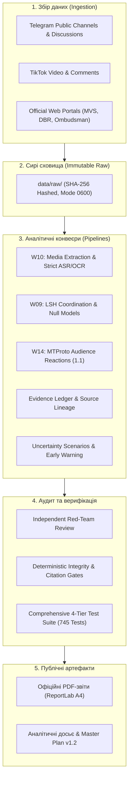

# SOCIAL — Computational Sociology & Information Warfare Intelligence

[](https://www.python.org/)
[](tests/)
[](wiki/)
[](CLAUDE.md)
[](reports/borshchahivka-report.md)
[](reports/orchestrator/masterplan-closeout-2026-11-08-final.md)

> **SOCIAL** — це науково-орієнтована система обчислювальної соціології, аналізу інформаційного простору та OSINT-розвідки. Вона призначена для відтворюваного виявлення дезінформаційних хвиль, скоординованої неавтентичної поведінки (CIB), ботоферм і гібридних інформаційно-психологічних операцій (ІПСО).

Проєкт побудовано за методологією **LLM-Wiki (патерн Андрія Карпатого)**: людина обирає напрями, джерела та валідує гіпотези, а агентська система автономно веде базу знань, програмний код, тести, емпіричний аудит і журнал операцій.

---

## 🎯 Чому це важливо: Подолання критеріального тупика

Аналіз інформаційної війни часто стикається з двома крайнощами:
1. **Голослівний алармізм:** оголошення будь-якого обурення чи критики «роботою ГРУ/ФСБ» без інфраструктурних або статистичних доказів.
2. **Юридичний параліч:** відмова фіксувати ворожу кампанію до появи вироку суду чи оприлюднення перехоплень спецслужб, що робить аналітику запізнілою на місяці.

**SOCIAL вирішує цю дилему через строгу епістемологічну дисципліну:**
* **Градація доказів (A/B/C/D):** від прямих інструментальних вимірювань (A) до неперевірюваних тез (D).
* **Розмежування вимірів:** заява прес-служби відомства — це *факт заяви органу*, але не обов'язково *фізичний факт події*.
* **[Протокол раннього попередження (Early Warning)](wiki/methods/russian-influence-attribution-early-warning.md):** прогнозування та виявлення операцій за цифровими аномаліями (синхронізація таймінгів, аномальні лексичні збіги LSH/Jaccard, сітки каналів-донорів), навіть коли замовник приховує сліди.

---

## 🔬 Ключове розслідування: Інцидент у Петропавлівській Борщагівці (2–5 листопада 2026)

Система була розгорнута для поглибленого автономного розслідування резонансних подій та інформаційної хвилі навколо конфлікту на Софіївській/Петропавлівській Борщагівці (сутички, чутки щодо ТЦК/поліції, відео пожежі з коментарями про «замітання слідів»).

```
                      ХРОНОЛОГІЯ ТА ЦИФРОВИЙ СЛІД
                      
  2–3 ЛИСТОПАДА           3–4 ЛИСТОПАДА             4–5 ЛИСТОПАДА
┌────────────────┐      ┌─────────────────┐       ┌──────────────────┐
│ Локальний      │ ───► │ TikTok/Telegram │  ───► │ Офіційні заяви   │
│ інцидент       │      │ Розгін хвилі    │       │ МВС, ДБР, НПУ    │
│ побутова тема  │      │ 369 пар комент. │       │ Контр-наративи   │
└────────────────┘      └─────────────────┘       └──────────────────┘
        │                        │                          │
        ▼                        ▼                          ▼
 607 відео Telegram      LSH Jaccard ≥ 0.60         3 публікації PDF
 100% full decode        p = .0016 (аномалія)       A4, ReportLab
```

### Досягнуті емпіричні результати:
* **Відео-пайплайн (W10):** **607/607 Telegram-відео** та 20 TikTok-кліпів повністю розкодовано без помилок через `ffmpeg -xerror`.
* **Захист транскриптів:** Сирий ASR захищено від перезапису (`0600`/`0700`). Усі 10 гіпотез виправлення утримуються зі статусом `quote_safe: false` до проведення акустичної верифікації слухачем.
* **Координація та нульові моделі (W09):** Аудит LSH виявив 369 скоординованих пар коментарів у 30-хвилинних вікнах (recall 99.46%). Тест Монте-Карло з 9 999 перестановками підтвердив штучну координацію ($p = .0016$ з корекцією Голма).
* **Аналіз реакцій (W14 / DR4):** Повний паритет 10/10 із живим MTProto Telegram API. Реалізовано схему 1.1 із розмежуванням емодзі та платної валюти Telegram Stars.
* **Аудит релізу:** 65 із 65 публічних артефактів звірено байт-у-байт і хеш-у-хеш проти маніфесту релізу.

---

## 🏛 Архітектура системи



---

## 📑 Офіційні PDF-звіти (A4 Dossiers)

Усі звіти скомпільовано детермінованим генератором публікацій на базі ReportLab та верифіковано в [manifest-2026-11-08.json](output/pdf/manifest-2026-11-08.json):

| Документ | Обсяг | Призначення | Посилання |
|:---|:---:|:---|:---:|
| **Головний аналітичний звіт** | 16 стор. (~70 тис. симв.) | Повна реконструкція інциденту в Борщагівці, хронологія, розбір пожежі, коментарів та джерел | [Переглянути PDF](output/pdf/petropavlivska_borshchahivka_report_2026-11-08.pdf) |
| **Фігуранти та процесуальний статус** | 11 стор. | Довідник згадуваних осіб, офіційні підозри, матеріали проваджень Нацполіції та ДБР | [Переглянути PDF](output/pdf/petropavlivska_figures_and_proceedings_2026-11-08.pdf) |
| **Протокол раннього попередження й атрибуції** | 7 стор. | Методологія виявлення гібридних інформаційних операцій за непрямими маркерами | [Переглянути PDF](output/pdf/russian_influence_attribution_early_warning_2026-11-08.pdf) |

---

## ⚡ Швидкий старт (Quickstart)

### 1. Клонування та налаштування середовища
```bash
git clone https://github.com/cyberdid/social.git
cd social

# Створення віртуального оточення
python3 -m venv .venv
source .venv/bin/activate

# Встановлення контрактних та медійних залежностей
pip install -r requirements-contracts.txt
pip install -r requirements-video-local.txt
```

### 2. Запуск тестів
У репозиторії налаштовано понад 740 автоматичних тестів, які перевіряють контракти даних, стійкість до збоїв API та детермінізм розрахунків:

```bash
# Запуск швидких наскрізних acceptance-тестів (58 тестів за 0.15 с)
pytest tests/e2e/ -v

# Запуск повного тестового набору репозиторію
pytest tests/ -q
# Результат: 745 passed, 16 subtests passed
```

### 3. Перевірка цілісності артефактів
```bash
# Запуск звірки релізного маніфесту
python3 -c "
import json
with open('reports/case-release-manifest-2026-11-08.json') as f:
    manifest = json.load(f)
print(f'Кількість артефактів у релізі: {len(manifest[\"artifacts\"])}')
"
```

---

## 🗺 Структура проєкту

```text
├── CLAUDE.md              # Золоті стандарти та правила проєкту (LLM-Wiki)
├── README.md              # Цей документ
├── log.md                 # Повний незмінний аудит-трейл усіх операцій
├── config/                # Конфігурація каналів, ключових слів та груп
├── docs/
│   ├── plans/             # Master Plan (v1.0 -> v1.1 -> v1.2)
│   ├── research/          # Наукові звіти Deep Research (DR1–DR4)
│   └── specs/             # Специфікації архітектури, транскриптів та W14
├── output/pdf/            # Скомпільовані фінальні A4 PDF-звіти з маніфестом
├── reports/
│   ├── orchestrator/      # Підсумкові звіти Teamwork (Closeout, Red-Team, Video, Audience)
│   ├── video-pipeline/    # Аудит розкодування 607 відео та ASR-рецепти
│   └── audience-response/ # MTProto паритет-чеки та реакційні матриці
├── schemas/               # JSON-схеми валідації контрактів даних
├── scripts/reports/       # Скрипти генерації аналітичних досьє та звітів
├── src/analysis/          # Ядро аналізу (LSH, координація, ASR, реакції, невизначеність)
├── tests/
│   ├── e2e/               # Наскрізні багаторівневі інтеграційні тести
│   └── fixtures/          # Контрактні фікстури для офлайн-тестування
└── wiki/                  # База знань, методи та протокол атрибуції
```

---

## 🛡 Принципи етики, приватності та безпеки (OPSEC)

1. **Незмінність сирих даних:** Дані в `raw/` та `data/raw/` ніколи не змінюються вручну і зберігаються з контрольними сумами SHA-256.
2. **Нульовий витік персональних даних:** Проєкт не профілює приватних осіб, не зберігає в репозиторії списки реакторів, персональні телефонні номери, токени чи солі хешування.
3. **Захист від семантичних вигадок:** Жодна здогадка штучного інтелекту не маркується як дослівна цитата (`quote_safe`), доки звук не перевірено фізичним прослуховуванням.
4. **Науковий скептицизм:** Якщо доказів недостатньо, система зобов'язана повертати статус `unknown` або `insufficient_evidence`, а не конструювати зручну відповідь.

---

## 📜 Ліцензія та авторство

Проєкт розроблено в рамках досліджень обчислювальної соціології та моніторингу інформаційних загроз.  
**Контакт:** [Cyberdid](https://github.com/cyberdid)  
Всі права захищено © 2026.
