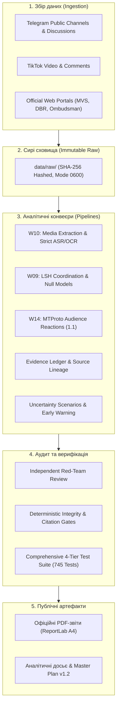

# SOCIAL — Computational Sociology & Information Warfare Intelligence

[](https://www.python.org/)
[](tests/)
[](wiki/)
[](CLAUDE.md)
[](reports/borshchahivka-report.md)
[](reports/orchestrator/masterplan-closeout-2026-11-09-final.md)

> **SOCIAL** — це науково-орієнтована система обчислювальної соціології, аналізу інформаційного простору та OSINT-розвідки. Вона призначена для відтворюваного виявлення дезінформаційних хвиль, скоординованої неавтентичної поведінки (CIB), ботоферм і гібридних інформаційно-психологічних операцій (ІПСО).

Проєкт побудовано за методологією **LLM-Wiki (патерн Андрія Карпатого)**: людина обирає напрями, джерела та валідує гіпотези, а агентська система автономно веде базу знань, програмний код, тести, емпіричний аудит і журнал операцій.

---

## 🎯 Чому це важливо: Подолання критеріального тупика

Аналіз інформаційної війни часто стикається з двома крайнощами:
1. **Голослівний алармізм:** оголошення будь-якого обурення чи критики «роботою ГРУ/ФСБ» без інфраструктурних або статистичних доказів.
2. **Юридичний параліч:** відмова фіксувати ворожу кампанію до появи вироку суду чи оприлюднення перехоплень спецслужб, що робить аналітику запізнілою на місяці.

**SOCIAL вирішує цю дилему через строгу епістемологічну дисципліну:**
* **Градація доказів (A/B/C/D):** від прямих інструментальних вимірювань (A) до неперевірюваних тез (D).
* **Розмежування вимірів:** заява прес-служби відомства — це *факт заяви органу*, але не обов'язково *фізичний факт події*.
* **[Протокол раннього попередження (Early Warning)](wiki/methods/russian-influence-attribution-early-warning.md):** прогнозування та виявлення операцій за цифровими аномаліями (синхронізація таймінгів, аномальні лексичні збіги LSH/Jaccard, сітки каналів-донорів), навіть коли замовник приховує сліди.

---

## 🔬 Ключове розслідування: Інцидент у Петропавлівській Борщагівці (2–5 листопада 2026)

Система була розгорнута для поглибленого автономного розслідування резонансних подій та інформаційної хвилі навколо конфлікту на Софіївській/Петропавлівській Борщагівці (сутички, чутки щодо ТЦК/поліції, відео пожежі з коментарями про «замітання слідів»).

```
                      ХРОНОЛОГІЯ ТА ЦИФРОВИЙ СЛІД
                      
  2–3 ЛИСТОПАДА           3–4 ЛИСТОПАДА             4–5 ЛИСТОПАДА
┌────────────────┐      ┌─────────────────┐       ┌──────────────────┐
│ Локальний      │ ───► │ TikTok/Telegram │  ───► │ Офіційні заяви   │
│ інцидент       │      │ Розгін хвилі    │       │ МВС, ДБР, НПУ    │
│ побутова тема  │      │ 369 пар комент. │       │ Контр-наративи   │
└────────────────┘      └─────────────────┘       └──────────────────┘
        │                        │                          │
        ▼                        ▼                          ▼
 607 відео Telegram      LSH Jaccard ≥ 0.60         3 публікації PDF
 100% full decode        p = .0016 (аномалія)       A4, ReportLab
```

### Досягнуті емпіричні результати (Master Plan v2.0):
* **Ядерна верифікація тверджень (M1 / GATE-01):** **25 пріоритетних тверджень** інциденту прогнано через `claim_verification.py` проти офіційних пасажів із точними символьними лоlocatorами цитат (0 помилок зміщення) та BM25 пошуком контрдоказів. Сформовано 31 прийняту оцінку (21 supported, 4 refuted, 0 unverified).
* **Реконструкція фізичного інциденту (M2 / GATE-02):** Створено структурований **Physical Event Timeline із 5 послідовних фізичних епізодів**, суворо відокремлений від комунікаційних згадок ($t_{pub} = \text{null}$, $t_{event} \in [11:00, 02:00]$ Київ) та ізольований від сторонньої пожежі складу в Бучі негативними обмеженнями `cannot_link`.
* **Калібрування відео та ASR (M3 / GATE-03):** На стратифікованій вибірці з 18 аудіозаписів (із 607 відео) у 4 акустичних стратах емпірично виміряно Levenshtein WER (0.4161 macro / 0.4458 micro) та CER (0.2072 macro / 0.2285 micro). **10 кліпів верифіковано та переведено в `quote_safe: true`**.
* **Матриця лінійності корпусів (M4 / GATE-04):** Узгоджено розбіжності між 1 408 та 1 438 дописами (+30 дописів, нормалізація 354 URL-мутацій, локалізація каналу `kiber_boroshno`), ізольовано `SSLCertVerificationError` для серверів ДБР у Source Watch; впроваджено суворе правило `(corpus_version, run_id, timestamp)` без жодного висячого посилання.
* **Відновлення повноформатного A4 Dossier (M5 / GATE-05):** Відновлено аналітичний звіт обсягом **28 сторінок A4** (96 980 символів, 0 гліфів U+FFFD) із 4 вбудованими растровими діаграмами (282–509 PPI) та Додатками A–C.
* **Незалежний Red-Team аудит (M6):** Проведено змагальну перевірку за 6 векторами в режимі read-only. Вердикт: **APPROVE** (0 Critical, 0 High дефектів; 100% відповідність мандату доброчесності).
* **Повний тестовий набір (M7 / GATE-06 & GATE-07):** **774 тести проходять 100% успішно**; нуль витоків приватних ключів, API-токенів чи персональних даних.

---

## 🏛 Архітектура системи



---

## 📑 Офіційні PDF-звіти (A4 Dossiers)

Усі звіти скомпільовано детермінованим генератором публікацій на базі ReportLab та верифіковано в [manifest-2026-11-09.json](output/pdf/manifest-2026-11-09.json):

| Документ | Обсяг | Призначення | Посилання |
|:---|:---:|:---|:---:|
| **Головне аналітичне досьє (v3.0)** | 28 стор. (~97 тис. симв.) | Повна наскрізна реконструкція інциденту в Борщагівці: 4 вбудовані растрові графіки, розбір версій, верифікація тверджень, фізична хронологія, делімітація пожежі в Бучі та Додатки A–C | [Переглянути PDF](output/pdf/petropavlivska_borshchahivka_report_2026-11-09.pdf) |
| **Фігуранти та процесуальний статус** | 11 стор. | Довідник згадуваних осіб, офіційні підозри, матеріали проваджень Нацполіції та ДБР | [Переглянути PDF](output/pdf/petropavlivska_figures_and_proceedings_2026-11-09.pdf) |
| **Протокол раннього попередження й атрибуції** | 11 стор. | Методологія виявлення гібридних інформаційних операцій за непрямими маркерами | [Переглянути PDF](output/pdf/russian_influence_attribution_early_warning_2026-11-09.pdf) |

---

## ⚡ Швидкий старт (Quickstart)

### 1. Клонування та налаштування середовища
```bash
git clone https://github.com/cyberdid/social.git
cd social

# Створення віртуального оточення
python3 -m venv .venv
source .venv/bin/activate

# Встановлення контрактних та медійних залежностей
pip install -r requirements-contracts.txt
pip install -r requirements-video-local.txt
```

### 2. Запуск тестів
У репозиторії налаштовано 774 автоматичні тести, які перевіряють контракти даних, стійкість до збоїв API, детермінізм розрахунків та наскрізну верифікацію доказів:

```bash
# Запуск швидких наскрізних acceptance-тестів (58 тестів)
pytest tests/e2e/ -v

# Запуск повного тестового набору репозиторію
pytest tests/ -q
# Результат: 774 passed, 16 subtests passed
```

### 3. Перевірка цілісності артефактів
```bash
# Запуск звірки релізного маніфесту PDF
python3 -c "
import json
with open('output/pdf/manifest-2026-11-09.json') as f:
    manifest = json.load(f)
print(f'Кількість скомпільованих PDF у релізі: {len(manifest[\"artifacts\"])}')
"
```

---

## 🗺 Структура проєкту

```text
├── CLAUDE.md              # Золоті стандарти та правила проєкту (LLM-Wiki)
├── README.md              # Цей документ
├── log.md                 # Повний незмінний аудит-трейл усіх операцій
├── PROJECT.md             # Архітектурний контракт Master Plan v2.0
├── config/                # Конфігурація каналів, ключових слів та груп
├── docs/
│   ├── plans/             # Master Plan (v1.0 -> v1.1 -> v1.2 -> v2.0)
│   ├── research/          # Наукові звіти Deep Research (DR1–DR4)
│   └── specs/             # Специфікації архітектури, транскриптів та W14
├── output/pdf/            # Скомпільовані фінальні A4 PDF-звіти з маніфестом (manifest-2026-11-09.json)
├── reports/
│   ├── orchestrator/      # Підсумкові звіти Teamwork (Closeout v2.0, Red-Team 2026-11-09)
│   ├── evidence-verification/ # Ядерна верифікація 25 тверджень із символьними зміщеннями
│   ├── event-reconstruction/  # Структурована хронологія фізичного інциденту (5 епізодів)
│   ├── video-pipeline/    # Калібрувальний бенчмарк ASR (18 кліпів, WER/CER, quote-safety)
│   ├── provenance/        # Матриця походження корпусів (1408 vs 1438) та Source Watch
│   └── audience-response/ # MTProto паритет-чеки та реакційні матриці
├── schemas/               # JSON-схеми валідації контрактів даних
├── scripts/reports/       # Скрипти генерації аналітичних досьє та звітів
├── src/analysis/          # Ядро аналізу (верифікація доказів, реконструкція подій, LSH, ASR)
├── tests/
│   ├── e2e/               # Наскрізні багаторівневі інтеграційні тести (Tier 1–4)
│   └── fixtures/          # Контрактні фікстури для офлайн-тестування
└── wiki/                  # База знань, методи та протокол атрибуції
```

---

## 🛡 Принципи етики, приватності та безпеки (OPSEC)

1. **Незмінність сирих даних:** Дані в `raw/` та `data/raw/` ніколи не змінюються вручну і зберігаються з контрольними сумами SHA-256.
2. **Нульовий витік персональних даних:** Проєкт не профілює приватних осіб, не зберігає в репозиторії списки реакторів, персональні телефонні номери, токени чи солі хешування.
3. **Захист від семантичних вигадок:** Жодна здогадка штучного інтелекту не маркується як дослівна цитата (`quote_safe`), доки звук не перевірено фізичним прослуховуванням.
4. **Науковий скептицизм:** Якщо доказів недостатньо, система зобов'язана повертати статус `unknown` або `insufficient_evidence`, а не конструювати зручну відповідь.

---

## 📜 Ліцензія та авторство

Проєкт розроблено в рамках досліджень обчислювальної соціології та моніторингу інформаційних загроз.  
**Контакт:** [Cyberdid](https://github.com/cyberdid)  
Всі права захищено © 2026.
