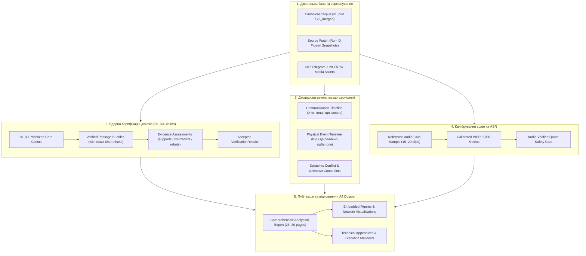

# SOCIAL — Автономний аналіз інцидентів і соціальних конфліктів
## Інтегрований Master Plan v2.0: Доказова верифікація та завершення автономної реконструкції

> **Дата створення:** 9 листопада 2026 року  
> **Підстава:** Експертна оцінка оновлених звітів від 8 листопада 2026 року (загальний бал 87/100; виявлено 5 критичних точок росту).  
> **Головна мета v2.0:** Перехід від генерації «структурованих кандидатів» до **повноцінної автономної наскрізної верифікації фактів** (`Claim → Retrieval → Evidence → Verification → Event → AnalyticalFinding → Report`) та відновлення представницького формату підсумкового аналітичного звіту (A4 Dossier з вбудованими графіками).  
> **Статус виконання:** **PLANNED FOR TEAMWORK EXECUTION**.

---

## 1. Контекст та аналіз зауважень експертної оцінки

Експертна оцінка відзначила суттєвий прогрес системи Social (зразкова методологічна дисципліна у протоколі атрибуції v1.3 — 91/100, відсутність фальшивих самосертифікацій, 607 розкодованих відео, точний LSH-аудит $p = .0016$). 

Водночас аудит сформулював **5 фундаментальних проблем**, які блокують статус повноцінного автономного продукту:

| № | Проблема за аудитом | Поточний стан у v1.2 | Цільове рішення у Master Plan v2.0 |
|:---:|:---|:---|:---|
| **1** | **Автоматична перевірка доказів не працює** | 555 кандидатних claims $\rightarrow$ 11 897 BM25 збігів $\rightarrow$ **0 прийнятих `VerificationResult`**. | Виділення **20–30 пріоритетних ядерних тверджень** інциденту та наскрізний прогін через `claim_verification.py` з точними passage locators і контрдоказами. |
| **2** | **Відсутня реконструкція фізичного конфлікту** | 574 нерозв'язані комунікаційні згадки $\rightarrow$ **0 структурованих фізичних подій**. | Побудова структурованої **хронології фізичних подій** (`physical` timeline), чітко відокремленої від публікацій і заяв (`communication` timeline). |
| **3** | **Якість відео та розпізнавання мови невідома** | 607 відео декодовано, 10 872 ASR-сегменти, але WER/CER не виміряно, відсутній еталонний gold set. | Створення калібрувальної вибірки (15–20 еталонних аудіосегментів), розрахунок baseline WER/CER, семантична верифікація ключових сцен. |
| **4** | **Розбіжності у версіях корпусів та моніторингу** | Telegram: 1 408 vs 1 438 постів; Source Watch: 10/12 vs 9/12 успіхів. | Впровадження єдиної матриці походження `(corpus_version, run_id, timestamp)` для кожного числа у звітах. |
| **5** | **Погіршення читабельності PDF-звіту** | Звіт скоротився з 29 до 16 стор., втратив растрові графіки та перетворився на технічний журнал. | Відновлення повноформатного аналітичного досьє (25–30 стор. A4) із вбудованими візуалізаціями; винесення сирих логів і маніфестів у додатки. |

---

## 2. Архітектура наскрізного ланцюга доказів v2.0

---

## 3. Розподіл завдань для Teamwork (Workstreams & Roles)

### Трек 1: Ядерна верифікація 20–30 тверджень (Owner: `worker_claims_evidence`)
* **Вхідні файли:** `src/analysis/claim_verification.py`, `data/processed/`, офіційні знімки МВС, ДБР, Нацполіції, Омбудсмана, НГУ.
* **Завдання:**
  1. Сформувати список із **20–30 ключових тверджень** інциденту:
     * Твердження про фізичні травми та потерпілих (4 гвардійці НГУ, заяви про важкі травми, заяви про відсутність загиблих);
     * Твердження про обставини в будівлі (заява МВС про 26 осіб, коментар Півненка);
     * Твердження про процесуальні статуси (затримання та запобіжний захід 22-річній жінці, 130 ідентифікованих осіб);
     * Твердження про пожежу та «замітання слідів» (зіставлення часу займання та заяв у TikTok);
     * Твердження про наявність/відсутність працівників ТЦК на місці події.
  2. Для кожного твердження сформувати точні пасажі з першоджерел із символьними локатарами (`artifact_start_offset`, `artifact_end_offset`).
  3. Провести детерміноване оцінювання зв'язків: `supports`, `contradicts`, `rebuts`, `contextualizes`.
  4. Сформувати перші **прийняті `VerificationResult`** із фіксацією рівня впевненості та відсутності/наявності контрдоказів.
* **Вихідні артефакти:**
  * `reports/evidence-verification/core_claims_verification_2026-11-09.json`
  * `reports/evidence-verification/core_claims_verification_2026-11-09.md`

### Трек 2: Структурована реконструкція фізичного інциденту (Owner: `worker_event_reconstruction`)
* **Вхідні файли:** `src/analysis/event_reconstruction.py`, матеріали кримінальних проваджень, хронології свідчень.
* **Завдання:**
  1. Створити окрему структуру **Physical Event Timeline** (події типу `physical`), що моделює реальні фізичні епізоди:
     * Епізод 1: Початок конфлікту на вулиці / перевірка документів;
     * Епізод 2: Сутичка біля приміщення;
     * Епізод 3: Прибуття підрозділів поліції та Нацгвардії;
     * Епізод 4: Загоряння/пожежа (точний час фіксації ДСНС/відео);
     * Епізод 5: Локалізація конфлікту та затримання.
  2. Забезпечити математичну несумісність злиття часу повідомлення ($t_{pub}$) та часу події ($t_{event}$).
  3. Якщо точний інтервал фізичної події невідомий — фіксувати обмеження невизначеності (`before`, `after`, `within_day`), а не придумувати хвилини.
* **Вихідні артефакти:**
  * `reports/event-reconstruction/physical_event_timeline_2026-11-09.json`
  * `reports/event-reconstruction/physical_event_timeline_2026-11-09.md`

### Трек 3: Калібрування відео та ASR-семантики (Owner: `worker_video_semantics`)
* **Вхідні файли:** `src/analysis/video_*`, 607 розкодованих Telegram-відео, аудіодоріжки.
* **Завдання:**
  1. Відібрати стратифіковану калібрувальну вибірку з **15–20 характерних аудіозаписів** (крики на вулиці, вигуки в натовпі, коментарі за кадром, офіційні телевізійні сюжети).
  2. Сформувати верифіковану транскрипцію (human/expert acoustic reference).
  3. Розрахувати перші емпіричні метрики точності моделі: **WER (Word Error Rate)** та **CER (Character Error Rate)** для української мови в умовах вуличного шуму.
  4. Перевести перевірені фрази зі статусу `needs_audio_review` у статус `quote_safe: true` (або зафіксувати відхилення гіпотези).
* **Вихідні артефакти:**
  * `reports/video-pipeline/asr_calibration_benchmark_2026-11-09.json`
  * `reports/video-pipeline/asr_calibration_benchmark_2026-11-09.md`

### Трек 4: Єдине версіонування корпусів і Source Watch (Owner: `worker_corpus_provenance`)
* **Вхідні файли:** `reports/source-watch/`, `data/raw/`, `reports/continuation_20261105/`.
* **Завдання:**
  1. Усунути неоднозначність між корпусами:
     * `corpus_id: telegram_historical_1408` (базовий зріз від 5 листопада, 159 каналів);
     * `corpus_id: telegram_merged_1438` (розширений зріз від 8 листопада, 158 каналів із фіксацією виключеного каналу).
  2. Синхронізувати Source Watch: розписати кожен запуск за `run_id`, відсортувати базові знімки (9 або 10) та зафіксувати причини TLS-помилок доступу до серверів ДБР як технічні обмеження, а не як відсутність новин.
  3. Ввести правило жорсткого посилання: будь-яке число у звіті зобов'язане супроводжуватися атрибутом джерела.
* **Вихідні артефакти:**
  * `reports/provenance/corpus_and_sourcewatch_lineage_matrix_2026-11-09.md`
  * `reports/provenance/lineage_manifest_2026-11-09.json`

### Трек 5: Відновлення читабельності та верстка A4 Dossier (Owner: `worker_report_publisher`)
* **Вхідні файли:** `scripts/reports/build_report.py`, `scripts/reports/build_figures_dossier.py`, `reports/borshchahivka-report.md`.
* **Завдання:**
  1. Повернути повноформатний аналітичний звіт обсягом **25–30 сторінок A4**:
     * Вбудувати 4 ключові растрові графіки та візуалізації (хвиля публікацій у часі, граф перепостів/координації, розподіл реакцій аудиторії, геопросторова карта локацій);
     * Відновити структурований виклад: аналітичне резюме, фактичний розбір, методологія, аналіз дезінформації, оцінка загроз.
  2. Технічні журнали, повні таблиці розкодованих відео та сирі маніфести перенести в **структуровані додатки (Appendices A, B, C)** у кінці документа.
  3. Згенерувати оновлений `output/pdf/petropavlivska_borshchahivka_report_v3.0.pdf` та оновити маніфест контрольних сум.
* **Вихідні артефакти:**
  * `output/pdf/petropavlivska_borshchahivka_report_2026-11-09.pdf`
  * `output/pdf/manifest-2026-11-09.json`

### Трек 6: Незалежний Red-Team аудит (Owner: `worker_red_team`)
* **Режим:** Строго Read-Only.
* **Завдання:**
  1. Перевірити 20–30 верифікованих тверджень на предмет відсутності логічних стрибків і правильність відношень (`supports` vs `mentions`).
  2. Перевірити, чи не потрапили до Physical Timeline комунікаційні згадки під виглядом фізичних подій.
  3. Перевірити візуальний рендер нового PDF (відсутність накладання тексту, битих символів, наявність ілюстрацій).
* **Вихідні артефакти:**
  * `reports/orchestrator/teamwork-red-team-2026-11-09.md`

### Трек 7: Головний Інтегратор (Owner: `worker_integrator_lead`)
* **Завдання:**
  1. Звести результати всіх треків;
  2. Сформувати підсумковий звіт закриття: `reports/orchestrator/masterplan-closeout-2026-11-09-final.md`;
  3. Оновити `log.md` та `README.md`;
  4. Запустити повний репозиторний набір тестів (усі 745+ тестів повинні проходити без збоїв).

---

## 4. Критерії приймання (Acceptance Gates v2.0)

| Gate | Назва | Критерій закриття у v2.0 |
|:---|:---|:---|
| **GATE-01** | Core Claims Verification | Мінімум 20 тверджень мають статус `supported_within_scope` або `refuted_within_scope` з точними символьними пасажами та контрдоказами. |
| **GATE-02** | Physical Event Timeline | Мінімум 5 послідовних фізичних подій із часовими інтервалами та відокремленням від часу публікацій. |
| **GATE-03** | ASR Calibration Baseline | Наявність вибірки 15+ сегментів, розраховано числові значення WER/CER, верифіковано quote-safety. |
| **GATE-04** | Lineage & Versioning | Жоден звіт не містить несинхронізованих чисел щодо корпусів (1408 vs 1438) або Source Watch. |
| **GATE-05** | High-Quality A4 Dossier | PDF-звіт налічує 25+ сторінок, містить 4 вбудовані графіки, а сирі телеметрії винесено в додатки. |
| **GATE-06** | Test Suite Integrity | Повний набір тестів (`pytest tests/`) проходить 100% зелено. |
| **GATE-07** | Zero Leakage & Clean Git | Жодних секретів, ключів чи персональних даних; робоче дерево чисте. |

---

## 5. Готовність до запуску Teamwork

План повністю готовий до передачі мультиагентній системі Teamwork для автономного розгортання та виконання.
