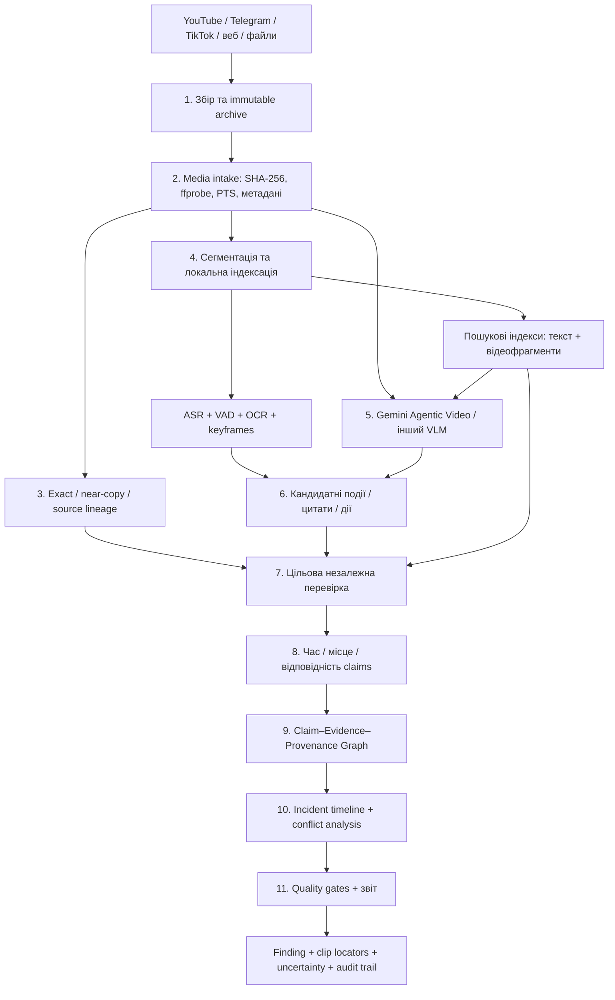

# Social — Video Evidence Processing Pipeline v0.1

> **Статус:** архітектурний концепт для обговорення, не готове технічне завдання та не опис уже реалізованої системи.  
> **Мета:** автономно перетворювати відео, аудіо, скриншоти й похідні публікації на відтворювані **кандидатні спостереження та перевірювані докази**, придатні для реконструкції соціального інциденту.  
> **Принцип:** *модель знаходить і описує; система перевіряє й фіксує межі доказу; звіт не виходить за ці межі.*

## 1. Цільовий результат

Для кожного відео Social має вміти відповісти:

1. **Що є у файлі?** Технічні властивості, доступність аудіо, пошкоджені фрагменти, тривалість, джерело й збережена копія.
2. **Що видно та чути?** Спостережувані дії, мовлення, написи, об'єкти й зміни сцени — із посиланнями на конкретні фрагменти.
3. **Що це за матеріал?** Оригінальна публікація, репост, перекодована копія, фрагмент іншого запису або невизначена спорідненість.
4. **Якого часу й місця він стосується?** Не плутати час у відео, час запису, публікації та реальної події.
5. **Яке твердження він підтримує?** Наприклад, «у кадрі видно фізичний контакт», але не автоматично «було незаконне застосування сили».
6. **Чого він не доводить?** Особу, мотив, причину травми, повноту події поза кадром, дату або місце без незалежних підстав.
7. **Чи достатньо доказів для звіту?** Якщо ні — зафіксувати `insufficient_evidence`, `conflicting_evidence` або `unverified`.

**Виходи:** `MediaAsset`, `VideoSegment`, `TranscriptSpan`, `VisualObservation`, `MediaMatch`, `EvidenceAssessment`, `VerificationResult`, `AnalyticalFinding`, а також машинозчитуваний `coverage_report` і посилання на перевірювані фрагменти.

## 2. Повний конвеєр



### 2.1. Приймання та архівування (обов'язково)

- Джерела: локальний файл, URL публікації, Telegram media, YouTube, TikTok, відеофайл із медіа, прямий ефір або його запис.
- Зберегти **оригінальні отримані байти**, оригінальний URL/пост, час отримання, статус доступності, обмеження доступу, `SHA-256`, MIME, розмір, ланцюг завантаження та версію колектора.
- **Не перезаписувати оригінал** після транскодування, обрізання, зменшення роздільності чи нормалізації. Усі похідні зберігати з `derived_from`.
- Якщо відео недоступне, а є лише пост, прев'ю чи субтитри — зберегти `media_unavailable` та фактичне покриття; не імітувати перегляд недоступного відео.
- Не передавати медіа в хмарний API до перевірки допустимості передачі, конфіденційності, можливих персональних даних і політик проєкту.

### 2.2. Технічний розбір медіа

`ffprobe` / PyAV / FFmpeg створюють технічний `MediaAsset`:

- контейнер, кодеки, тривалість, роздільність, FPS, variable-frame-rate, audio streams, sample rate, channel layout;
- початкові та змінні PTS/DTS, пропуски, несинхронність audio/video, обертання, пошкодження кадрів;
- технічні й заявлені метадані (`creation_time`, EXIF, C2PA за наявності) з вказаним походженням, **без визнання їх доказом дати/місця**;
- часову карту між оригіналом і похідними кліпами (`child_offset ↔ original_offset`), бажано на базі фактичних PTS, а не лише `frame_index / fps`.

Часові поля **різні**: `media_offset_ms`, `recording_time_claim`, `publication_time`, `fetched_at`, `event_time_interval`. `media_offset_ms=00:12:30` — позиція в записі, **не** 12:30 за годинником.

### 2.3. Пошук копій та походження

Використати наявний `src/analysis/media_fingerprints.py` як стартову реалізацію:

- `SHA-256` — тотожні байти;
- pHash/dHash і порівняння sampled frames — кандидати на перекодовані, обрізані або повторно опубліковані фрагменти;
- вирівнювання matched intervals між файлами, оцінка довжини й покриття збігу;
- перевірка проти хибних збігів: однакові заставки, чорні поля, водяні знаки, типові натовпи;
- граф походження `same_bytes`, `near_copy_candidate`, `shared_segment_candidate`, `quoted_from`, `reuploaded_from`, `unknown`.

**Ключове правило:** 20 репостів одного кліпу — 20 публікацій, але не 20 незалежних відеосвідчень. Найраніший *знайдений* файл не обов'язково є оригіналом.

### 2.4. Систематична локальна індексація відео

Це **не** заміна Agentic Video, а контрольне покриття всього доступного запису.

- Segment/shot detection та scene boundaries.
- Контрольна сітка кадрів із конфігурованою частотою; keyframes; додаткові кадри навколо переходів і аномальних ділянок.
- VAD і часові фрагменти аудіо.
- ASR для української/російської та змішаного мовлення, слово/фраза → інтервал у відео. Зберігати `unintelligible`, паузи й перекриття голосів.
- OCR із кадрів: сам текст, bounding box, час у відео, модель/версія, невизначеність.
- За потреби diarization: `speaker_0`, `speaker_1`; **не** ототожнювати голос із реальною людиною без окремих доказів.
- Побудувати індекс BM25/FTS для транскриптів/OCR та мультимовний embedding-індекс для пошуку перефразувань.

Сітка кадрів не гарантує виявлення подій тривалістю долі секунди. Для критичних ділянок потрібен **густіший повторний перегляд оригіналу**. Інструменти: FFmpeg/PyAV, OpenCV, VAD, Whisper-подібний ASR, Tesseract або PaddleOCR — остаточний вибір лише після локального benchmark.

### 2.5. Семантичний відеоаналіз: Gemini як кандидатний детектор

Інтерфейс: `VideoUnderstandingProvider`, із можливими реалізаціями `GeminiAgentic`, `GeminiStatic`, `LocalVLM`, `Disabled`.

**Agentic Video** рекомендовано як початковий provider для довгих відео й питання-орієнтованого пошуку моментів. Запити можуть бути такими:

- які *видимі* фізичні дії є в ролику, з інтервалами;
- де змінюється кількість присутніх людей (не обов'язково точний count);
- де видно контакт, блокування проходу, транспорт, вогонь, прибуття нових осіб;
- де звучать конкретні фрази, які вже виділено як claims;
- які фрагменти можуть відповідати конкретній заяві із Telegram.

**Вихід моделі — лише `observation_candidate`:** опис, interval у відео, тип дії, цитата/кадри для перевірки, uncertainty, model/version, prompt, processing mode, token/cost trace. Модель **не встановлює** законність дій, приховані мотиви, фізичні травми чи державну атрибуцію.

Для коротких важливих фрагментів використовувати цільовий static/VLM-pass із кадрами, витягнутими безпосередньо з оригіналу. Дозволити fallback на локальну модель, коли передавання даних у хмару заборонене або API недоступне.

**Ризик:** агентний перегляд вибірковий; навіть висока якість відповіді не означає повного покриття всіх секунд. Зберігати `inspected_intervals`, `uninspected_intervals`, обмеження та невирішені питання. Для Gemini також зберігати `interaction.steps`/ознаки реального agentic processing, якщо вони доступні.

### 2.6. Цільова перевірка кандидатів (evidence verification)

Кожен критичний кандидат проходить незалежний від вільного тексту моделі ланцюг:

1. Витяг оригінального фрагмента за точними інтервалами, із запасом контексту *до* і *після* події.
2. Перевірка відповідності інтервалу кадрам та audio/ASR; фіксація незрозумілих ділянок.
3. Повторне застосування іншого способу перевірки: близькі кадри, OCR, ASR або VLM на короткому кліпі. Згода двох моделей — **не** незалежне свідчення.
4. Нормалізація лише видимих/чутних фактів: `actor_description`, `action`, `object`, `visible_count_range`, `time_offset`, `visibility_limitations`.
5. Перевірка, чи не описує результат лише текст підпису/субтитрів замість відеозапису.
6. Результат `visual_observation_candidate`, `supported_within_visible_scope`, `insufficient_evidence`, `conflicting_evidence` або `not_verifiable` відповідно до перевіреного обсягу доказів.

Для сцен зі швидкими діями, травмами, конкретними особами або обвинуваченнями встановити вищу вимогу до перевірки; за недостатніх даних автоматично **утриматися від висновку**.

### 2.7. Геолокація, час і контекст

Це окремі перевірки, а не частина одного `video_verified=true`:

- `location`: OCR/вивіски/особливості місцевості → пошук кандидатних місць → OpenCV feature matching/RANSAC, за потреби LoFTR → доказова оцінка; якщо не доведено — `unresolved`;
- `recording_time`: підтверджені часові межі з публікацій, годинників, освітлення, погоди чи синхронізованих подій; EXIF і timestamp-overlay — лише твердження про час;
- `editing_continuity`: помітні монтажні переходи/заміни аудіо, але їх наявність **не доводить** маніпулятивного задуму;
- `same_event`: зіставлення місця, часу, дії, ракурсу, джерельних залежностей та несумісних альтернатив;
- `caption_relation`: підпис може бути правдивим, неповним, суперечливим, вирваним із контексту або неперевірним.

Ніколи не виводити дату, геолокацію, причину чи ідентичність особи лише з опису VLM.

### 2.8. Зіставлення відео з текстовими твердженнями

`Claim–Evidence Matcher` отримує атомарний claim із Social і шукає релевантні фрагменти в OCR, ASR, візуальних спостереженнях і сусідніх публікаціях.

Для кожного зв'язку обов'язкові: `claim_id`, `evidence_id`, `relation`, точні часові/просторові межі, `speaker`, `supports/contradicts/mentions/contextualizes`, `model`, `verification_state`.

Приклад розділення:

- «Відео містить слова “людей побили”» → перевіряється аудіо/ASR та цитата.
- «На відео видно фізичний контакт» → перевіряється кадрами.
- «Людей незаконно побили» → **не встановлюється** лише з цих двох спостережень; це інше твердження з додатковими юридичними, причинними й часовими вимогами.

### 2.9. Claim–Evidence–Provenance Graph

До спільного графа Social передавати тільки структуровані записи з прив'язкою до оригінальних байтів і locators:

- `MediaAsset` → `VideoSegment` → `VisualObservation` / `TranscriptSpan` / `OCRSpan`;
- `Source` → `Publication` → `MediaAsset` (із lineage та невідомою незалежністю);
- `Claim` ↔ `EvidenceAssessment` ↔ `Observation` / `TranscriptSpan`;
- `EventMention` → `EventCandidate` → `IncidentTimeline`;
- `VerificationResult` → `AnalyticalFinding` → фінальний звіт.

Повідомлення про подію, видима дія, фактична подія і висновок аналітика — **різні об'єкти**. Всі оцінки мають `as_of`, `source_cutoff`, `model_version`, `supersedes`; виправлення створює нову версію, а не переписує попередню.

### 2.10. Автономний фінальний звіт

Звіт генерується **не з відеочату**, а з перевірених `AnalyticalFinding`:

- коротка хронологія підтверджених/заявлених подій;
- таблиця ключових фрагментів: медіа, `mm:ss.mmm`, опис видимого/чутного, перевірений scope, unresolved аспекти;
- незалежність матеріалів: копії, спільні первинні джерела, невідомі зв'язки;
- важливі суперечності з посиланнями на обидві сторони;
- межі: що не вдалося встановити, чого не було в кадрі, де відео недоступні;
- технічний provenance та індекс для відтворення кожного твердження.

Генератору **заборонено** перетворювати «видно людину, що лежить» на «людина загинула», «людина у формі» на встановлену службову належність або медійний пік на фізичну ескалацію. Після генерації кожне емпіричне речення проходить citation/schema/number/time/entailment gates; семантична перевірка залишається недосконалою й оцінюється на benchmark.

## 3. Мінімальний контракт запису

```json
{
  "observation_id": "obs_example_001",
  "asset_id": "sha256:<hash_of_original_video>",
  "segment": {
    "start_ms": 754000,
    "end_ms": 759000,
    "time_basis": "original_media_pts"
  },
  "type": "visual_observation_candidate",
  "description": "У кадрі дві постаті наближаються до входу",
  "visible_only": true,
  "source_locator": {
    "asset_id": "sha256:<hash_of_original_video>",
    "frame_refs": ["frame_754200", "frame_756800"]
  },
  "model": {
    "provider": "gemini",
    "processing": "agentic",
    "name": "configured_model_id",
    "prompt_version": "video_observations_v1"
  },
  "verification": {
    "state": "candidate",
    "checks": ["timestamp_valid", "asset_exists"],
    "unresolved": ["recording_date", "geolocation", "person_identity"]
  },
  "run_id": "video_run_001"
}
```

Це **ілюстративний контракт**, не фінальна JSON Schema і не твердження про конкретний інцидент. У production потрібні schema validation, реальні хеші, дійсні frame locators, точні модельні ID й окремі evidence assessments.

## 4. Оркестрація, відтворюваність та автономність

- Pipeline — **state machine / DAG** із станами `queued`, `processing`, `complete`, `partial`, `blocked`, `failed`, `needs_recheck`.
- Кожен крок має `input_artifact_ids`, `output_ids`, `tool_version`, `model_id`, `params`, `started_at`, `finished_at`, `cost`, `error`.
- Кешувати за `(original_hash, operation, model_version, parameters_hash)`; нова версія моделі не підміняє старі результати.
- Хмарні provider-и через адаптери. `allow_cloud=false` блокує upload; недоступність API веде до локального fallback або `partial`, а не до вигаданого аналізу.
- Планувальник дає LLM лише дозволені read-only інструменти; текст із відео, субтитрів і постів вважається недовіреним input, а не інструкцією.
- Бюджети на asset/incident: тривалість, кількість викликів, вартість, найбільша пріоритетність невирішених claims, повторне дослідження тільки нових/спірних сегментів.
- Інкрементальне оновлення: нове відео, виправлений підпис або нові докази інвалідовують лише залежні assessments/timeline/findings.

## 5. Контроль якості та acceptance gates

| Перевірка | Критерій |
|---|---|
| Integrity | Жодне посилання на неіснуючий файл/фрагмент/хеш не потрапляє у звіт |
| Time | `publication_time`, `recording_time` і `event_time` не зливаються без підстав |
| Citation | Кожен висновок має реальний locator; його наявність сама по собі не доводить правдивість |
| Copy invariance | 1 → 100 репостів не збільшують кількість незалежних відеосвідчень |
| Short action | На контрольних відео перевіряється пропуск коротких дій і помилка локалізації |
| Multimodal claims | ASR, OCR та VLM не перетворюються автоматично на підтвердження реальної події |
| Context | Старе відео з новим підписом не стає новою фізичною подією |
| Editing | Монтаж із різних кліпів зберігає segment-level lineage |
| Contradictions | Несумісні твердження залишаються доступні; невизначеність не замінюється голосуванням |
| Abstention | Якщо ключова ознака невстановлена, звіт прямо зазначає `unresolved` |

**Оцінювати емпірично:** event precision/recall; temporal localization error; ASR WER та hallucinated-span rate; OCR CER; duplicate retrieval precision/recall за низької частоти хибних збігів; false geolocation; evidence-to-claim support accuracy; unsupported assertions; частку невиявлених коротких подій; вартість і latency на хвилину відео. Окремо вимірювати якість UA/RU та шумних/коротких/довгих записів.

Фіксовані ручно перевірені контрольні набори потрібні **під час розроблення й періодично для аудиту**; людина не потрібна в runtime кожного інциденту. Автономний результат може бути частковим, але з доказовими обмеженнями.

## 6. Інтеграція з поточним `cyberdid/social`

**Повторно використати** (згідно з read-only аудитом у Deep Research; перед реалізацією звірити поточний commit):

- `src/archive_sources.py` — архівування первинних HTML/джерельних артефактів;
- `src/source_watch_collect.py` — моніторинг джерел і версій;
- `src/analysis/media_fingerprints.py` — hashes, fingerprint і пошук збігів;
- `src/youtube_subtitles_collect.py` — доступні платформні субтитри;
- `src/analysis/youtube_evidence_audit.py` — облік доказового покриття;
- `src/analysis/youtube_content_analyze.py` — наявний downstream consumer, потребує окремої інспекції;
- `src/analysis/prep.py` — нормалізація корпусів.

**Нові модулі (пропозиція, не твердження про наявні файли):**

```text
src/video/
  intake.py                  # asset metadata, timestamps, decode receipts
  segments.py                # scene/shot/audio intervals, PTS mappings
  asr_ocr.py                 # transcript and OCR extraction adapters
  index.py                   # multimodal/text retrieval
  provider.py                # VideoUnderstandingProvider interface
  gemini_agentic.py          # cloud provider adapter
  local_vlm.py               # optional local provider
  observations.py            # candidate visual/audio observations
  verify.py                  # target clips, checks and evidence assessments
  provenance_adapter.py      # connect to the shared evidence graph
  coverage.py                # processed/unprocessed/uncertain intervals
  pipeline.py                # orchestration, cache, retry, budgets
  schemas/                   # JSON Schema / Pydantic contracts
  tests/                     # frozen media fixtures and adversarial checks
```

Сховища: оригінали й похідні в content-addressed файловому архіві; JSONL як відтворюваний export; SQLite для індексів і зв'язків. Велика графова БД на першому етапі не потрібна.

## 7. Етапи впровадження

### P0 — доказовий мінімум

1. Immutable archiving, технічні метадані, часові карти та схеми `MediaAsset`/`VideoSegment`.
2. Адаптер до наявного fingerprint-модуля й source lineage.
3. Локальні ASR/OCR/segment extraction з точними offsets або явним статусом недоступності.
4. Provider API для Gemini/локальних моделей; результат лише `observation_candidate`.
5. Evidence records + Claim–Evidence Graph + deterministic citation/time gates.
6. Мінімальний звіт із фрагментами, підтвердженим scope і `unresolved`.

### P1 — точність та ширина покриття

1. Agentic Video на довгих файлах + targeted static/dense-frame перевірка важливих епізодів.
2. Відкалібровані candidate matching, copy/segment alignment, OCR/ASR quality tests.
3. Геометрична перевірка кандидатних сцен, часовий та контекстний аудит.
4. Побудова timeline фізичних/інформаційних подій та інкрементальна переоцінка.
5. End-to-end benchmark на кількох зафіксованих інцидентах, зокрема коротких діях і помилкових підписах.

### P2 — розширення

- Action localization models (якщо статистика пропусків доведе потребу).
- Learned copy retrieval для великих медіаархівів.
- Складна автоматична геолокація й chronolocation.
- Повноцінний forensic analysis підроблених/синтетичних медіа.
- Масштабування на великий відеокаталог / пошук між інцидентами.

## 8. Чого **не** робити

- Не генерувати один вільний опис усього відео й не називати його доказовою реконструкцією.
- Не вважати Agentic Video суцільним переглядом кожного кадру.
- Не вважати повторні публікації незалежними доказами.
- Не трактувати ASR-субтитри як безпомилкове цитування.
- Не робити юридичних, медичних, причинних або персональних висновків із зовнішнього вигляду кадру.
- Не підміняти відсутність доказів доказом відсутності події.
- Не будувати власну велику відеомодель до оцінки простого гібридного baseline.

## 9. Критерій готовності першої робочої версії

На вибраному тестовому наборі Social здатен **без ручних дій під час запуску**: отримати відео, зберегти його оригінал, створити індекс, виділити кандидати спостережень, показати точні відповідні фрагменти, відстежити копії, прив'язати спостереження до окремих claims, згенерувати звіт **без емпіричних речень без доказових locators**, позначити невідомі обставини та повторити процедуру з тим самим snapshot/config. Точність визначається не декларацією, а окремими метриками на замороженому зовнішньому еталоні.

---

### Джерельна основа концепту

- *Autonomous Social Conflict and Incident Reconstruction — Scientific Methods and System Architecture, 2026*, розділи 3–5, 7–13 (особливо стор. 15–18 і 23–25).
- Google: *Introducing agentic video understanding with Gemini* (1 вересня 2026 року).
- Google AI for Developers: *Video understanding — Agentic video understanding* (актуальна API-документація, перевірена 7 листопада 2026 року).

Наведена архітектура — **моя інтеграційна пропозиція** на основі джерел, а не дослівний дизайн Google і не вже реалізований стан Social.
