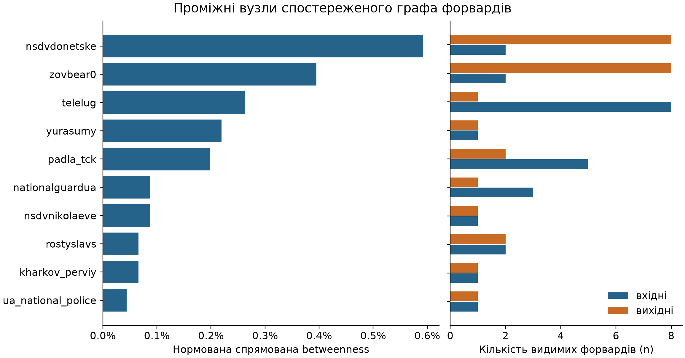
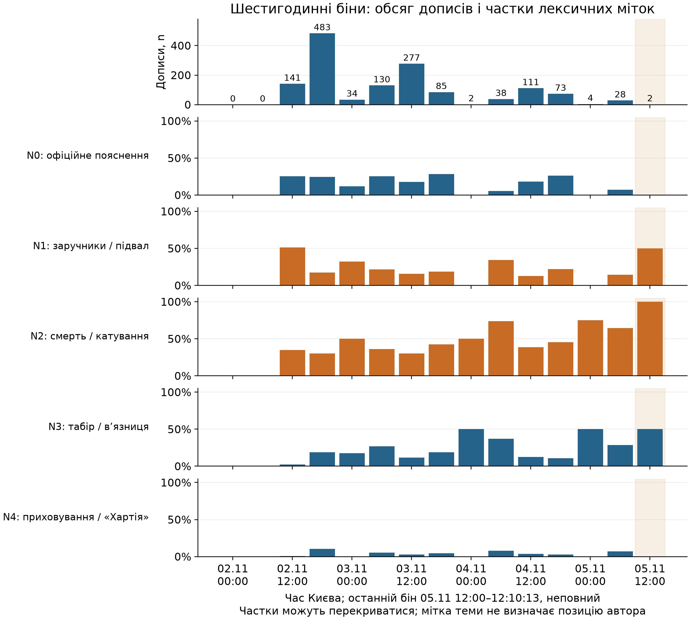

# Інформаційна хвиля довкола Петропавлівської Борщагівки (02–05.11.2026): незалежна перевірка

**Версія 2.12, 2026-11-08.** Додано відтворюваний candidate-only offline case-run, звірку знаменників Telegram між двома snapshot, W04/W05 crosswalk, source-watch, реальний replay на зафіксованих входах, локальний CPU ASR-прохід по 607 Telegram-відео, обмежену перевірку другого ASR на 7 відео та strict technical full decode 607 унікальних локальних Telegram assets. Виправлено надмірні формулювання щодо статусу 130 осіб, TikTok-коментарів і сигналів автоматизації; оновлено високоризиковий аудит цитувань та окрему хронологію публічних комунікацій. Технічне декодування не підтверджує належність кожного файла до інциденту, зміст сцен, час/місце зйомки чи правдивість підписів. Висновки про семантичну точність, автентичність джерел і фізичні події не підвищувалися; ці аспекти залишаються неоціненими або невстановленими.

**Основний набір даних:** `data/processed/continuation_20261105` — об'єднання веб-знімків t.me/s і API-знімків Telegram. Збірка: `src/analysis/build_continuation.py`, перевірки: `src/analysis/continuation_audit.py`, результати: `reports/continuation_20261105/{results.json,audit_results.json}`.
**Попередня фіксація:** `wiki/precommit/2026-11-05-borshchahivka-claims.md` (до аналізу) і додатковий протокол `wiki/precommit/2026-11-05-continuation-protocol.md` (після v1.1, до API-аналізу; не сліпий).
**Хронологія фактів:** `wiki/borshchahivka-facts-timeline.md`.

## Головне

1. **Початок хвилі в Telegram встановлено до секунди, і він збігається з КіберБорошном та ЦПД:**
   - 12:41:03 — gnapinfo, «~40 людей у підвалі зі слів медиків»;
   - 13:07:53 — padla_tck, «Будні концтабору»;
   - 13:16:21 — перший великий канал, «Реальний Київ» (1,56 млн підписників);
   - 13:57:01 — перший у цій Telegram-панелі допис каналу з попередньою legacy-міткою C: «Украина.ру» (`ukr_2025_ru`), з поміткою «сообщают киевские СМИ». Це пізніше підхоплення в панелі. Legacy-мітка не є новою перевіркою походження, а час не доводить російського ініціювання чи державного керування.
2. **«Затишшя великих каналів 13:49–16:14» спростовано.** За зафіксованим порогом «великий канал» = ≥100 тис. підписників у цей проміжок публікували «Украина.ру» (13:57, 494 тис.) і «Реальна Війна» (14:00:26, 1,54 млн, 342 тис. переглядів). Висновок той самий і для порогів 0,5 млн та 1 млн.
3. **Ім'я `@ukraina_ru` не належить медіа «Украина.ру».** Через API видно, що це канал на 351 підписника, створений у листопаді 2024 року, без постів у вікні. Справжній канал медіа — `ukr_2025_ru`. Хто перевіряє «Украина.ру» за очевидним ім'ям, перевіряє не той канал.
4. **У каналах попередньої legacy-групи C спростувань «медика» не знайдено**, натомість були контрспростування: «машина Банковой», «антикриз», «по ОПшным заказам», саркастичне «виноватые найдены, расходимся». Єдиний нейтральний переказ заяви Буданова (`georgeivensiya`, 32 тис. переглядів) походить із каналу, якому C було поставлено лише автоматично (за посиланням на RuTube). Це опис старої мітки, не нова перевірка походження всіх каналів.
5. **Географічна плутанина навколо TikTok-відео з написом «Софіївська Борщагівка».** У знімку з 883 коментарів алгоритм відібрав 69 кандидатів для ручного читання; серед них 21 коментар класифіковано як підтримку/алюзію на приховування слідів, а 20 — як географічну корекцію. Це підрахунок цільово відібраних коментарів, а не повне кодування 883 записів. У Telegram фраза «може спалахнути, щоб знищити докази» з'явилася 02.11 о 18:08 (padla_tck), до окремої складської пожежі 4–5 листопада, але не обов'язково до будь-якої пожежної події. Джерельний аудит також містить неперевірене повідомлення про можливу іншу пожежу в ніч на 2 листопада.
6. **У застосованій перевірці не виявлено поведінкових сигналів автоматизації.** У знімку 883 коментарі від 724 акаунтів; топ-5 акаунтів дали 5% коментарів. За заданими правилами не знайдено синхронних копій чи сплесків, і жоден із вручну прочитаних кандидатів «замітають сліди» не походить від акаунта, позначеного цими правилами. Це не доводить, що коментування було органічним, і не є бот-вердиктом (`reports/tiktok-fire/automation_signals.md`).
7. **Головні застереження щодо методу:**
   - Частка «94% переглядів до спростування» (КіберБорошно) **не вимірюється** за поточними лічильниками. Ми бачимо лише, скільки переглядів *зараз* мають пости, опубліковані до 21:32, а не скільки вони мали на 21:32.
   - Частки наративів, отримані правилами, — це **згадки**, а не підтримка.
   - Порядок публікацій схожих текстів у групах B і C — це **порядок**, а не доведене копіювання.
8. **Скоординоване коментування на підтримку Буданова** (`reports/telegram-comments/coordinated-comments.md`). Під 4 постами із заявами Буданова 3.11 («Инсайдер UA», «Труха», «Україна Online») з'явилися 126 шаблонних фраз похвали. Кожну опублікували різні акаунти, по одному разу в кожному обговоренні: 438 коментарів від 367 акаунтів, рівномірно, з медіанним інтервалом ~1 хв, 21–36% усіх коментарів під цими постами. 321/367 акаунтів без імені користувача (87,5%) та 86,6% без фото, тоді як серед інших коментаторів тих самих обговорень таких 69% і 62%. Скоординованість — рівень B. Організатор не встановлюється. Під російськими каналами шаблонного коментування майже немає.
9. **Telegram показує різні тексти через API і через веб-перегляд.** У 319 з 1 408 релевантних постів (22,7%; 25% переглядів) веб-віджет показує не той текст, що API, за того самого ID і часу. Обидва джерела стабільні в часі. Лексика коментарів підтримує API-версію у 78 випадках проти 15 (115 постів з коментарями). Ключові пости для вердиктів (gnapinfo, padla_tck, «Реальний Київ», «Київ Головне», «Украина.ру», «Реальна Війна») не зачеплені. Висновок для методики: тексти брати з API, а дослідження, що спираються лише на `t.me/s`, можуть містити чужі тексти.
10. **Повторна перевірка 06.11** (проміжна, до 12.11): 1 408 з 1 408 постів доступні, **видалень немає**. Перегляди за добу зросли в медіані на 1% (90-й перцентиль — 8%), тож хвиля в Telegram фактично завершилась.
11. **YouTube.** Серед 617 метаданих 463 мають `upload_date` від 02.11 до моменту збору. Лексичне правило `бор[щш]|borsh` у заголовку/описі відбирає 444 відео зі **190 унікальних каналів**: 34 618 058 переглядів сумарно за знімками, 44 записи ефірів; 243/444 (54,7%) опубліковані 03.11. Це відбір за метаданими з ризиком випадкових згадок і пропусків. Найраніший знайдений ролик — 02.11 о 17:50:15 за Києвом; порядок у вибірці не встановлює, яка платформа ініціювала хвилю загалом. Із 25 933 коментарів до 30 відео 24 121 належать 26 відео лексичного відбору. Переконливого текстового патерну кампанії не виявлено; часові та профільні тести не оцінюються через якість/відсутність полів. [Детальний аудит](youtube-comments/youtube-summary-2026-11-06.md).
12. **TikTok через Telegram.** У постах і коментарях Telegram знайдено 20 посилань на TikTok, з них 12 — на **прямі ефіри** 10 акаунтів. Їх поширювали в коментарях 02.11 з 17:06 до 22:47, саме тоді, коли біля будинку збирався натовп. Слова ОП про TikTok-ефіри частково підтверджено: ефіри існували й просувались через Telegram, але їхнє охоплення не вимірюється. Два відео, на які дали посилання в коментарях, зібрано разом із коментарями: 03.11 «повний розбір» (685 тис. переглядів, у коментарях домінує «постанова, хтось проплатив») і 04.11 **контрспростування** «вона справжній медик» (280 тис.; «у автора видео уже удалили»). За застосованими поведінковими правилами переконливого патерну автоматизованої кампанії в цих коментарях не виявлено; ботність акаунтів не встановлюється.
13. **Нова цільова вибірка TikTok.** За 42 прямими посиланнями користувача зібрано 9 653 записи коментарів (21 відео й 21 фото). Лише 28,2% від суми заявлених платформою коментарів верхнього рівня повернулися як ID; курсорна пагінація не означає повний перепис. Новий сканер v1.1 відібрав 5 прямих згадок про приховування слідів під трьома публікаціями та 4 непрямі натяки на «прибирання»; критерії й контекст явно розділені, але жоден з отриманих коментарів не згадує Софіївську Борщагівку або пожежу. Це не спростовує окремий кейс із відео пожежі. Ознак синхронного копіювання на заданих порогах не знайдено; поведінкові сигнали не є бот-вердиктом. Відео й фото TikTok не переглядалися: аналіз охоплює метадані, підписи відео та коментарі. Деталі й обмеження: [`reports/tiktok/manual-batch-20261106.md`](tiktok/manual-batch-20261106.md).
## Дані

| Панель | Що | Обсяг |
|---|---|---|
| Веб v2 `20261105T101013Z` | 78 заданих стартових каналів + видимі форварди/посилання глибиною до 2 | 105 каналів: 78 початкових, 14 першого й 13 другого кроку; 16 379 постів |
| Веб, розширення `20261105T102914Z` | 134 початкових канали, на які повторно посилалися канали C, + видимі посилання глибиною 1 | 150 каналів; 8 перетинаються з першою панеллю |
| API `20261105T104050Z` + `20261105T104252Z` | 241 запитаний ідентифікатор у тому самому часовому вікні; платний пошук не використовувався | 236 API-історій повні; 5 не були доступні як broadcast channel; один FloodWait завершено повторним проходом |
| **Об'єднаний набір** | Ключ «канал + ID повідомлення»; альбоми як одна публікація; API має пріоритет за текстами й лічильниками | **23 350 публікацій, 1 408 релевантних у 159 каналах** |
| TikTok, окремий кейс із відео з написом «Софіївська Борщагівка» | Публічне відео, без входу; геолокацію та час зйомки не підтверджено | 883 коментарі (345 + 538 відповідей) |
| TikTok, 42 прямі посилання | 21 відео й 21 фото; знімок 06.11 | 9 653 повернені записи коментарів; верхній рівень — 28,2% від суми лічильників API; метадані фото не отримані |
| Instagram, пошук у Chrome | `#петропавловскаяборщаговка`, знімок 06.11 | 199 посилань-кандидатів; декодований час: 119 у вікні аналізу, 12 після нього, 68 старіших. Зміст і коментарі не збережені, у висновки не включено |
| Коментарі Telegram | Обговорення під усіма 533 релевантними постами з відповідями (API, HMAC-псевдоніми) | **39 598 коментарів, 12 797 акаунтів** |
| YouTube | yt-dlp: 12 запитів × (релевантність + дата); збір відновлено після обмеження | 617 кандидатів, 463 за датою публікації у вікні; лексичний відбір 444 відео / 190 каналів. Коментарі: 25 933 / 30 відео; у лексичному відборі — 24 121 / 26 відео |
| Повторна перевірка | Віджет кожного з 1 408 релевантних постів, 06.11 07:15 UTC | 0 видалень; 319 розбіжностей тексту API/веб |
| Архів джерел | 27 статей і заяв (`raw/web/`), аудит першоджерел (`wiki/research-source-audit.md`) | 23 збережено |

**Релевантність:** повна назва села або «Борщагівка» разом із лексикою інциденту після 11:00 02.11; окремо виключено загальні згадки київських вулиць/масиву, транспорту й події у Софіївській Борщагівці, якщо вони не пов'язувалися з інцидентом 2 листопада. У 90 вручну переглянутих кандидатах було 2 хибні включення, але дизайн відбору цих 90 не збережений, тому частку 2/90 не подаємо як оцінку точності корпусу. Додатковий лематизований/нечіткий пошук у зібраних записах дав 70 невключених кандидатів; серед них є сторонні згадки й повідомлення, що можуть стосуватися інциденту. Їх не закодовано незалежно за наперед визначеним кодбуком. Отже, ні precision, ні recall не оцінювалися; 1 408 — число постів, відібраних правилом у цільовій панелі, а не повний перепис Telegram. Тексти без топоніма додатково шукав контекстний сканер, але це теж не оцінка повноти (`reports/contextual-misinformation-candidates.md`).

**Успадковані групи каналів:** A — місцеві, B — українські неофіційні, C — канали, які попередня композитна схема називала російськими/проросійськими, D — офіційні й редакційні, E — іноземні, U — невідомі. Панель цільова: 78 стартових каналів розширено до 105 через видимі форварди/посилання; друга хвиля — 134 стартові канали з повторними згадками у C плюс 16 каналів наступного кроку; API запросив 241 ідентифікатор, з яких 236 історій отримано повністю, а 5 були недоступні як broadcast channel. Ручна мітка має пріоритет над автоматичною. Категорії A–E/U взаємовиключні в таблиці, але C поєднує походження, інфраструктурні проксі, публічну атрибуцію органів і редакційно-політичні ознаки. У поточному W04-вимірюванні походження й орієнтація не переоцінювалися та залишилися невідомими. Старі групи не є новою атрибуцією, реєстром державного контролю чи оцінкою державного зв'язку для кожного каналу. Ручні мітки з обґрунтуванням: `config/channel_groups.csv`; автоматичні маркери лише проксі: `config/channel_groups_auto.csv`.

## Вердикти щодо 18 зафіксованих тверджень

Рівні доказовості: A — прямо виміряно; B — збігаються кілька незалежних джерел; C — одне джерело, ненадійне кодування або чутливість до визначень; D — нашими даними не встановлюється.

| # | Твердження | Результат на об'єднаному наборі | Вердикт | Рівень |
|---|---|---|---|---|
| KB1 | Перший Telegram-пост у панелі — gnapinfo, 12:41 | **12:41:03**; раніших релевантних постів у 159 каналах не знайдено за застосованим правилом. ЦПД ретроспективно називає 11:34 першим прямим публічним закликом приїхати до будинку у Threads; це інший, неперевірений первинним записом об'єкт | ✅ лише для цільової панелі | A |
| KB2 | padla_tck, 13:07, «Будні концтабору» | **13:07:53** | ✅ | A |
| KB3 | О 13:49 «40» підхопив перший великий канал (427 тис.) | Великі канали були раніше: kievreal1 13:16:21 (без «40»), kyiv_golovne 13:24:00 («40»). Поста о 13:49 немає ні у веб-, ні в API-даних | ❌ у такій формі | A |
| KB4 | Великі канали (≥100 тис.) мовчали 13:49–16:14 | ukr_2025_ru 13:57, voynareal 14:00:26 (так само для порогів 0,5 і 1 млн) | ❌ спростовано | A |
| KB5 | Друга хвиля з 16:14 | Постів за годину: 15:00 — 4, 16:00 — 37, 17:00 — 87 | ✅ | A |
| KB6 | Пік — 21:50, коли пояснення вже дали | Максимум у вікні 21:30–22:10 — інтервал 21:40 (29 постів за 10 хв); загальний максимум — 22:30 (32) | ◐ частково | A |
| KB7 | Перший російський — 13:57, переказ «киевских СМИ» | ukr_2025_ru **13:57:01**, «…– сообщают киевские СМИ» | ✅ | A |
| KB8 | 94% переглядів «зі слів медика» — до спростування о 21:32 | Пости, опубліковані до 21:32, мають 74,6% поточних переглядів таких постів. Скільки переглядів було **станом на 21:32**, без історичних лічильників встановити неможливо. Кодування «медика» правилами ненадійне (κ≈0) | ⚪ не встановлюється | D |
| KB9 | Спростування — 0% переглядів у каналах legacy-групи C | За ручними мітками C: жоден канал не поширює спростування; усі знайдені згадки — контрспростування або сарказм. З автоматичними мітками: один нейтральний переказ заяви Буданова (`georgeivensiya`, мітка лише за RuTube) | ✅ за legacy C (◐ з автоматичними мітками) | B |
| KB10 | UA←RU копіювання швидше (8,1 хв), ніж RU←UA (21,6 хв) | Перевірені пари (точний Jaccard ≥0,6): B пізніше C — n=3, медіана 2,5 хв; C пізніше B — n=4, медіана 51 хв. За порогів 0,75/0,9 пар лише 1–2. Напрям збігається, але n мізерне, а порядок ≠ копіювання | ⚪ недостатньо даних | D |
| KB11 | Більшість спільних текстів першими опублікували канали legacy-групи C (118/203) | У 141 компоненті текстових збігів канали C першими в 57 (40%) — найчастіше, але не більшість; панелі непорівнянні | ◐ | C |
| KB12 | «Концтабір» — переважно C, «заручники» — переважно B (за переглядами) | N3: C 95,7% знімкових лічильників; канал Strana.ua дає 24,6% усіх лічильників N3 у C, два найбільші — 40,8%. Без спірних/автоматичних міток C 88,9%, але лише на 81 пості та 4,37 млн лічильників проти повних 230 постів і 14,13 млн. N1: з автоматичними мітками C 40,4% проти B 35,6%; без них B 44,0% | Частка N3 висока, але концентрована й залежна від панелі/кодування; ◐ для N1 | B / C |
| KB13 | Офіційна версія мала найбільше переглядів | За правилами першим є N2 «смерть і катування» (32,4 млн), N0 — 24,3 млн | ❌ (чутливо до кодбука) | C |
| C1 | ЦПД: «Украина.ру» о 13:57 | ukr_2025_ru = «Украина.ру» (реєстр РКН), 13:57:01. `@ukraina_ru` — сторонній канал на 351 підписника | ✅ | A |
| C2 | ЦПД: ~19:00 110 російських каналів з однаковим заголовком «Концлагерь на Борщаговке, бунт украинцев» | У 241 каналі цього заголовка немає; найбільша група майже однакових російських текстів у 18:30–19:30 — 2 канали («Два майора» і його дубль). Нижня межа в нашій панелі не спростовує ширшу панель ЦПД | ⚪ не підтверджено в нашій панелі | D |
| C3 | ЦПД: перший прямий публічний заклик приїхати — Threads, 11:34 | Прямий матеріал ЦПД доступний, але первинний Threads-запис і його ID не збережені; НГУ/АрміяInform окремо описує повідомлення про травмованих. Це може бути та сама або інша публікація | ⚪ атрибутоване повідомлення, першопост і тотожність не перевірені | D |
| Z1 | Железняк: першим розганяв «Реальний Київ» | Перший **великий** канал (13:16), але на 35 хв пізніше за gnapinfo. Атрибуцію каналів до СБУ/ГУР нашими даними не перевірити | ◐ | A (час) / D (атрибуція) |
| L1 | ОП: найбільше вплинув TikTok | Існування й просування TikTok-ефірів у Telegram показано: 12 посилань на ефіри 10 акаунтів, 02.11 17:06–22:47. Їхнє охоплення й «найбільший вплив» не вимірюються. Instagram дав лише список 199 пошукових посилань без збереженого змісту; результати TikTok-пошуку не збережені | ◐ існування — так, «найбільше» — не встановлюється | B (існування) / D (вплив) |

## Географічні твердження в коментарях до TikTok-відео з пожежним написом

Деталі: `reports/contextual-misinformation-candidates.md` і `reports/tiktok-fire/comment_candidate_review.md` (Codex), статистика коментарів: `reports/tiktok-fire/automation_signals.md`.

- **Що встановлюють доступні записи.** Збережений аудит перелічує повідомлення керівника Київської ОВА о 00:03 і Борщагівської сільради о 00:17 05.11 про складську пожежу в Бучанському районі після ворожої атаки; тіла цих Telegram-дописів у цьому checkout не збережені. Тому тут це атрибутовані записи про публікації, а не повторно перевірені первинні повідомлення. Точний час займання, тип засобу ураження, назва власника складу та місце/час зйомки відео не встановлені. Напис «Софіївська Борщагівка, 05.11.26» у відео є накладеним текстом, а не незалежною геолокацією чи датуванням.
- **Раніша фраза в Telegram.** 02.11 о 18:08 padla_tck написав, що будівля «може спалахнути, щоб знищити докази»; пізніше kolobok_odesa і napovestkeki згадували «приховування слідів». Ці публікації передували окремій складській пожежі 4–5 листопада, але не можна стверджувати, що вони передували будь-якій пожежній події: локальний аудит містить також повідомлення про можливу іншу пожежу в ніч на 2 листопада, яку не вдалося прямо перевірити через недоступність першоджерела ДСНС. Немає доказу, що автори коментарів бачили або запозичили Telegram-фразу.
- **Що показує ручний перегляд коментарів.** У знімку є 883 коментарі; 69 автоматично відібраних кандидатів прочитано вручну. Серед них 21 коментар від 19 акаунтів класифіковано як підтримку/алюзію на приховування слідів, 20 від 18 акаунтів — як географічні корекції. Решта 814 не проходили повного ручного кодування, тому ці числа не оцінюють частки в усіх коментарях. У цій вибірці автори 21 підтримувального коментаря не мали визначених поведінкових сигналів автоматизації; це не доводить, що акаунти органічні. Виявленої координації у перевірених сигналах немає, але походження інтерпретацій та причинний зв'язок із Telegram не встановлено.
- **Алгоритм пошуку таких випадків** (`src/analysis/contextual_candidates.py`, Codex): приховування доказів, умовні прогнози пожежі, суперечки про статус медика, старе чи перепідписане медіа, конфлікт географії й дат, повторювані тексти. Це сигнали для ручної перевірки, а не вирок. На Telegram-корпусі сканер дав 99 кандидатів, у ручному реєстрі 18 прочитаних.

## Можливий російський вплив: раннє попередження й межі атрибуції

Російський актор не обов'язково створює початкову подію або перший допис. Для кожного випадку окремо перевіряємо **органічне виникнення, координоване поширення, підсилення вже наявної події, зв'язок із російською інформаційною мережею та державне керування**. Збіг із російським інтересом або наративом — сигнал для перевірки, не доказ замовника.

У цій панелі перший спостережений допис каналу з попередньою legacy-міткою C з'явився о 13:57, після ранніх дописів інших груп. Частина сюжетів, зокрема N3 «концтабір», отримала значне поширення серед каналів із цією старою міткою, але групове призначення не є новою перевіркою походження чи орієнтації. У релевантній підмножині 87 C-каналів 26 мали попередню ручну мітку, 61 — лише автоматичну; поточні W04 поля походження й орієнтації залишаються невідомими. Твердження ЦПД про прямий публічний заклик у Threads о 11:34 є доступним на первинній сторінці ЦПД, але первинний Threads-запис не отримано; окрема реконструкція НГУ/АрміяInform описує повідомлення про травмованих, і зв'язок між цими записами не встановлено. Повторювані Telegram-тексти й порядок їх появи не встановлюють спільне завдання: спільне джерело, звичайне новинне копіювання та неохоплені платформи лишаються альтернативами. Повідомлення ЦПД про 110 каналів із однаковим заголовком не відтворилося в нашій панелі й через різні вибірки не є ані підтвердженим нами, ані спростованим загалом.

**Поточна оцінка:** окремі сюжети поширювалися каналами, які попередня композитна схема відносила до групи C; це підстава для моніторингу за умови, що висновок лишається умовним щодо legacy-міток. Нові поля W04 не підтвердили походження/орієнтацію групи загалом. Наявний корпус не встановлює, що Росія ініціювала локальну подію, координувала первинні повідомлення, фінансувала учасників або керувала кампанією. Це невизначеність відкритих даних, а не твердження, що прихованого зв'язку точно не було.

Для подальших кейсів застосовується окремий протокол раннього попередження з двома незалежними оцінками: стан координації; зв'язок із російською інформаційною екосистемою та державна відповідальність. Він задає індикатори, альтернативні гіпотези, правила переходу від раннього сигналу до атрибуції та часові горизонти прогнозу: [`russian-influence-attribution-early-warning.md`](../wiki/methods/russian-influence-attribution-early-warning.md).

## Надійність кодування наративів

Перевірка: 50 постів для розробки правил, потім 40 нових незалежних постів. Другий кодувальник — Claude, вручну. Двох незалежних людських кодувальників немає.

| Мітка | κ на тестовій вибірці | Використання |
|---|---|---|
| N3 «Концтабір», N0 офіційна версія, спростування | 0,60–0,64 | висновки рівня B |
| N1, N2, N4, «зі слів медика» | від −0,07 до 0,13 | лише як «згадки», рівень C |

Основна причина: правила не відрізняють поширення чутки від її переказу для спростування.

## Що виправлено порівняно з v1.1 (за рев'ю Codex)

- **KB4.** У v1.1 «великий канал» трактувався як ≥0,5 млн, хоча зафіксовано було ≥100 тис. Тепер основний поріг — зафіксований, інші подано як чутливість. Вердикт від цього не змінився.
- **KB8.** Поточні лічильники більше не видаються за «перегляди, накопичені до 21:32». Вердикт — D.
- **Копії.** LSH лише пропонує кандидатів, кожну пару підтверджує точний Jaccard. Затримки рахуються по підтверджених парах, а не від першого поста транзитивного кластера. Порядок публікацій не називається напрямом передачі.
- **Повнота.** Виправлено хибне виключення «на улицах Борщаговки» як назви вулиці. Додано лексику «глава ОП», «тюрьма», «события».

## Надійність джерел тексту: API проти веб-перегляду

Деталі вище (пункт 9 «Головного»). Аналіз: `data/raw/telegram_recheck/continuation_20261105__20261106T071531Z`. Чутливість: якби брати веб-текст, 107 з 319 постів випали б із відбору, а мітки наративів змінились би в обидва боки (N0 −70/+28, N1 −46/+23, N2 −47/+19). Причина розбіжності не встановлена. Коментарі як незалежне свідчення переважно підтримують API.

## Література

Огляд 41 наукової роботи з перевіреними DOI: `wiki/methods/literature-review-2026-11-06.md`. Він обґрунтовує, чому ми не використовуємо Botometer-подібні бали, чому правила-словники — лише для пошуку кандидатів і чому координацію відокремлюємо від впливу.

## Обмеження

1. **Telegram:** 241 канал проти 3 273 у КіберБорошна. Абсолютні суми непорівнянні; порівнюємо порядок, часові мітки, частки. Перегляди — це не охоплення.
2. **Лічильники зібрано 05.11** — без історичних рядів. Будь-які висновки «до/після» щодо переглядів мають рівень D.
3. **Платформи:** Threads і Facebook не зібрано. Instaloader для Instagram отримав `login_required` і rate-limit; окремий браузерний пошук дав 199 посилань-кандидатів, але збережених підписів/коментарів немає, тому їх не аналізовано. TikTok: окремий кейс пожежі та 42 відео/фото за прямими посиланнями вже оброблені для доступних публічних коментарів; 21 фотопублікація не мала доступних метаданих, а коментарний набір частковий. Результати пошуку у відкритій вкладці не збережені. X — API без кредитів (402). Огляд: `wiki/methods/cross-platform-collection-tools.md` і `wiki/methods/platform-access-2026-11-06.md`.
4. **Групи каналів** частково спираються на атрибуцію держорганів і автоматичні маркери. Висновки щодо N1 від цього залежать.
5. **Ручне кодування** робили моделі (Claude, Codex), не дві незалежні людини.

## Що далі

1. **~12.11: повторна перевірка постів** (видалення, редагування, ріст переглядів): `cd ~/Projects/Social && nice -n 19 .venv/bin/python src/recheck_posts.py continuation_20261105` (1 408 постів). Цей окремий повторний збір не включено до crontab; встановлений розклад джерел наведено нижче.
2. **YouTube.** Лексичний відбір, часово-незалежний поведінковий аудит і збір субтитрів 54 відео завершено: 49 непорожніх текстів. Перечитано 56 фрагментів усіх 49 непорожніх текстів; повне кодування контенту та незалежна перевірка позицій залишаються потрібними.
3. **Історичні лічильники.** Щоб KB8 колись став вимірюваним, для майбутніх кейсів знімати лічильники кожні 15–30 хв під час хвилі.
4. **Інші платформи.** Threads і Facebook — через Meta Content Library (потрібна заявка), TikTok — через Research API або точкові відео за посиланнями користувача (DR7, `wiki/methods/cross-platform-collection-tools.md`).
5. **Людське кодування.** Стратифікована вибірка ~200 постів, двоє людей-кодувальників, довірчі інтервали для часток N1/N2.
6. **Публікація.** Звіт придатний як основа для препринту у форматі ваших попередніх робіт. Рішення за вами.

## YouTube: відтворюваність і межі нового аналізу

Скрипт `src/analysis/youtube_evidence_audit.py` перевіряє SHA-256 сирого знімка, експортує рішення відбору для всіх 617 відео й обчислює текстові показники окремо для всього збору та 26 відео лексичного відбору. Результати: `reports/youtube-comments/20261106T072121Z/evidence_audit.json`, `metadata_selection.csv`. Відбір ретроспективний; попередньою реєстрацією він не є. Верхня межа YouTube-вікна визначається збором, тому воно довше за основне Telegram-вікно.

Для 24 121 коментаря відібраної підмножини: 17 459 авторів, топ-10 — 0,92% коментарів, топ-1% (174 автори) — 6,33%, Джині 0,238. Чотири групи однакових текстів охоплюють 16 коментарів; пулів із ≥10 фраз, кожна з яких повторюється від ≥3 авторів по одному разу в тих самих ≥3 відео, немає. Такі пороги не охоплюють усі можливі форми координації.

Початковий `signals.json` містить 5 314 швидких пар S3, 82 акаунти з двома сигналами та профільні значення за замовчуванням. Для YouTube ці результати непридатні: приблизний час і відсутні поля профілю спотворюють часові та складені оцінки. Вони виключені з інтерпретації, а не використані як свідчення ботності. Відсутність пулу шаблонів не оцінює частку ботів.

**Уточнення Telegram:** 87,5% без username — 321 із 367 унікальних акаунтів кампанії; 87,2% — 382 із 438 шаблонних коментарів, залишених такими акаунтами. Різні знаменники пояснюють різницю.

## Оновлення процесуального контексту та джерел

Станом на зріз пошуку 06.11 о 15:40 репортажі Суспільного й hromadske повідомляють про 59 днів тримання Валерії Ладики під вартою з альтернативою застави; hromadske зазначає 66 560 грн. Це замінює попередній статус «рішення не знайдено». Даних про фактичне внесення застави чи звільнення не отримано. Суспільне з атрибуцією речниці прокуратури повідомило також про підозру Івану Паршонкову за ч. 1 ст. 114-1 КК. У переглянутих відкритих матеріалах довідка розрізняє п'ятьох поіменно названих підозрюваних у провадженнях, пов'язаних із перешкоджанням діяльності військових; це не повний список усіх фігурантів можливих проваджень. 05.11 Нацполіція повідомила, що разом із СБУ встановила 130 осіб, які можуть бути причетними до заворушень; це оперативна ідентифікація, а не кількість підозрюваних чи доведених учасників ([повідомлення НПУ](https://npu.gov.ua/news/politseiski-natsionalnoi-politsii-ukrainy-razom-z-sbu-vzhe-vstanovyly-130-osib-iaki-mozhut-buty-prychetnymy-do-zavorushen-na-petropavlivskii-borshhagivtsi)). Повних ухвал і підсумкових актів перевірок не отримано.

Виправлено помилки адрес МВС, НГУ та Уповноваженого ВРУ; повторні успішні HTTP-відповіді збережені з SHA-256. Для ДБР правильну адресу знайдено, але прямий запит мав TLS-помилку; отриманий індексований офіційний текст не прирівнюється до прямого завантаження. Реєстр судових рішень також не дав потрібних ухвал. [Повний аудит 25 запитів](source-refresh-2026-11-06.md), [оновлена довідка](figures-and-proceedings-2026-11-06.md).

## Нульові моделі: що додає статистична перевірка

Для S7 застосовано дві умовні перестановки, зокрема зі збереженням повного денного словника кожного автора та його слотів у гілках. Для часу копій застосовано циклічні зсуви контенту по фіксованих часових слотах кожного каналу, окремо в добових і двогодинних блоках. Ритм публікацій зберігається; глобального випадкового перемішування між каналами немає.

| Статистика | Спостережено | Середнє умовного фону | Центральні 95% фону |
|---|---:|---:|---:|
| Найбільший S7-пул, фрази; автор × день | 60 | 23,178 | 17–30 |
| Усі фрази у S7-пулах; автор × день | 111 | 37,429 | 24–50 |
| Копії Jaccard ≥0,6 у межах 10 хв; двогодинні блоки | 134/367 пар | 42,694/367 | 32–55 пар |

Кожен із 16 тестів має 9 999 перестановок, нуль перевищень, емпіричне p=(0+1)/(9999+1)=0,0001; поправка Holm для цієї родини дає 0,0016. Квантілі фону не є довірчими інтервалами суспільного або причинного ефекту. Відбір кейсу й розробка правил були ретроспективними; поправка не покриває історичний пошук гіпотез. Результат посилює підтримку незвичної узгодженості конкретного S7-пулу та часової близькості копій у корпусі. Звичайні передруки, спільні новинні джерела й організована активність реальних прихильників лишаються альтернативами; ботність, оплату й державну роль ці тести не встановлюють.

**126 проти 111 фраз:** 126 фраз і 438 коментарів утворюють широкий описаний кластер. Автоматичні S7-пули охоплюють 111 фраз, 393 коментарі, 334 автори. Решта 15 фраз мають два інші набори гілок розміру 8 і 7 фраз; кожен нижче порога ≥10. Це пояснення різниці критеріїв, а не втрата даних. [Повний звіт, усі 16 тестів та обмеження](coordination-null-models-2026-11-06.md).

## YouTube: отриманий зміст і розрізнення голосів

Зібрано субтитри для top50 за переглядами плюс 4 цільові доповнення за датами, форматами й маркерами заголовків. Із 54 спроб отримано 50 доріжок, з них 49 непорожніх текстів; 4 спроби не дали придатної доріжки. Мітки платформи: 45 автоматичних і 5 manual; остання не гарантує авторського редагування. Це цільова вибірка без репрезентативних ваг.

Один LLM-кодувальник прочитав 56 фрагментів усіх 49 непорожніх текстів. Контекст підтримує зв’язок із подією у 41 відео; у 8 коротких текстів його самостійно не встановлено. У текстах співіснують звинувачення, переказ чуток, заперечення поліції та вимоги перевірки. Наприклад, у новині про заяву «Азову» зачитування позиції корпусу й запитання ведучого належать різним голосам; у випуску «Є ПИТАННЯ» згадка 40 заручників входить до критики поширення історії без спростувань; у довгому ефірі є пізніше уточнення щодо компанії швидкої допомоги. Лексичний збіг без локального контексту змішує цитування, заперечення та інші сюжети багатотемних ефірів.

Позиція видавця не приписувалася за однією реплікою. Оригінальне аудіо не прослуховувалося, незалежного другого кодувальника немає. Поза перечитаними фрагментами виконано лише пошук кандидатних тем; частки підтримки наративів у всіх 444 відео не оцінювалися. [Звіт із прикладами та таймкодами](youtube-content-2026-11-06.md).

## Мережа форвардів і шестигодинна динаміка

Видимі форварди утворюють граф із 69 вузлів, 60 спрямованих зв'язків і 65 форвардів, із них 24 між різними групами каналів. Граф включає лише кінці видимих ребер; ручні копії та ізольовані канали відсутні. Найбільша нормована betweenness у nsdvdonetske (0,005926) та zovbear0 (0,003951), але їхні безпосередні зв'язки залишаються всередині C. Це не свідчення посередництва між Україною та РФ чи ролі організатора.

Для 1 408 публікацій побудовано 15 календарних шестигодинних бінів, два порожні; останній неповний містить лише два дописи. Частка мітки — число постів із нею, поділене на всі релевантні пости біна. Мітки перетинаються: 557 постів без них, 394 мають кілька міток; сума 1 424 призначень не дорівнює кількості постів. Це теми за існуючими правилами, а не позиції авторів. Через слабку валідацію частини міток, малу кількість точок і спільний новинний шок тест Грейнджера не застосовано.

[Методика графа, матриця переходів, усі часові біни й обмеження](telegram-network-dynamics-2026-11-06.md).

## Щоденний моніторинг джерел

Для чотирьох офіційних стрічок і восьми відомих матеріалів налаштовано користувацький cron о 10:00 за Europe/Kyiv. Попередній baseline extractor v2 датовано 06.11.2026. Додатковий реальний знімок створено 08.11.2026 о `08:05:50Z`: 10 із 12 адрес дали HTTP 200, дві адреси ДБР не пройшли перевірку TLS-сертифіката. У локальному архіві цей знімок є першою успішною версією для 10 сторінок, тому позначка `new_page` не означає, що сама публікація нова. Із 10 відповідей сім дали article-text фрагменти, три — стрічки/сторінки без придатного фрагмента; два запити ДБР не зберегли тіла. Помилки ДБР не означають відсутність публікацій. Кожен наступний сигнал потребуватиме перегляду; зміна HTML чи тексту сама по собі не підтверджує новину або юридичний висновок. [Квитанція source-linked прогону](automated-case-run-2026-11-08/source-linked-case-run-2026-11-08.md), [точкова перевірка першоджерел](source-watch/20261108/official-primary-source-review-2026-11-08.md). Розклад і методика: [документація моніторингу](../docs/source-watch.md); локальний маніфест: `data/raw/source_watch/20261108T080550.329799Z/manifest.json`.

## Новий пошук контексту, часові поля та доступ Instagram

Сканер v1.1 виправляє зворотний порядок і словоформи приховування слідів, додає контекст батьківського відео й окремий тип непрямого натяку. У партії 9 653 коментарів відібрано 166 кандидатів: 5 прямих згадок, 4 непрямі натяки й 157 медичних кандидатів. Це черга для перевірки; категорії не є кількістю дезінформаційних повідомлень. У кейсі пожежі черга збільшилася з 69 до 72: три нові репліки про «улики уничтожают» не додані мовчки до старого позиційного кодування 21/20. [Повторний аналіз](tiktok/context-recheck-20261106.md).

[Таблиця часу всіх 42 TikTok-публікацій](tiktok/publication-event-filming-times-20261106.csv) розрізняє ID-оцінку, platform timestamp, час події, час зйомки й час збору. Для 21 відео є yt-dlp `create_time/createTime`; для 21 фото platform timestamp немає. У спільному IncidentSpec-вікні опинилися 19 timestamped відеопублікацій, дві — поза ним. Незалежно встановлених часів зйомки в цій партії — 0. Зіставлення 21 відео не дало точних збігів ID-часу й platform timestamp: 20 різниць по 4–16 секунд та один розрив 9 183 секунди (2 год 33 хв 3 с). Причина не встановлена; membership у вікні в цих 21 відео не змінився.

Instagram: повторно відтворено 199 посилань і 119 оцінених ID-часів у вікні. Новий збір підписів/метрик не відбувся через технічну помилку керування браузером до читання сторінки. Публічна резервна спроба також не дала вмісту; старий Instaloader після rate-limit не повторювався. Це обмеження доступу, а не висновок про наявність/відсутність обговорення. [Квитанція і список кандидатів](instagram-access-20261106/README.md).

## Автономний офлайн-прогін Social (08.11.2026)

**Зріз даних:** `as_of=2026-11-08T01:14:07Z`; вікно публікацій — `2026-11-02T09:00:00Z`–`2026-11-05T10:31:42.738963Z` UTC. Прогін `run-post-fix` виконав детерміновані локальні модулі над уже зібраними матеріалами. Він не збирав нові дописи й не запускав модельну класифікацію. Стан — **partial**: усі доступні структурні кроки пройшли, але кілька доказових етапів залишилися невиконаними.

### Результати прогону

- **Кандидати тверджень і пошук джерел:** історичні артефакти `run-post-fix` фіксують 555 кандидатів, 23 архівовані фрагменти й 9 769 hits. Пізніший аудит встановив, що налаштований нульовий ліміт запитів було обійдено старим кодом через підстановку `top_k=20`; тому 9 769 — лише недійсна для compliant retrieval телеметрія. Це не результат завершеного аналітичного пошуку й не доказ ризику надмірного добору. В оригінальному case-run результатів перевірки — **0**. Окремий post-run обліковий прохід сформував 555 статусів `unverified` із незавершеним пошуком і без прийнятих підтримувальних чи спростувальних оцінок; це не семантична верифікація ([матриця тверджень](automated-case-run-2026-11-08/claim_matrix.md)). Окремий бюджетований source-linked пошук описаний у [receipt](automated-case-run-2026-11-08/source-linked-case-run-2026-11-08.md); подробиці та межі — у [corrigendum retrieval](automated-case-run-2026-11-08/retrieval-validity-addendum-2026-11-08.md).
- **Хронологія:** збережено 574 комунікаційні згадки-кандидати (555 Telegram-кандидатів та 19 TikTok-часів публікації). Усі 574 залишилися нерозв'язаними згадками; фізичних подій у часовій шкалі — **0**. Час публікації не встановлює час події чи зйомки.
- **Конфлікт і міжплатформне покриття:** у структурований модуль надійшло 0 записів фізичних дій і 0 записів позицій сторін; сформовано 13 шестигодинних бінів інформаційної уваги. Порожній фізичний шар означає відсутність таких записів у вході, а не відсутність фізичних дій. Окремий follow-up зіставив publication-candidate ряди Telegram, YouTube і TikTok в одному вікні. Instagram не мав придатних platform timestamps; для Facebook/Threads/X типізованих часових рядів немає. Повної міжплатформної реконструкції подій чи джерельної генеалогії не встановлено ([карта конфлікту й покриття](automated-case-run-2026-11-08/conflict_map.md), [міжплатформне зіставлення](cross-platform-publication-candidates-2026-11-08.md)).
- **Інформаційна динаміка Telegram:** 1 438 дописів із 158 каналів; сума зафіксованих лічильників переглядів — **119 515 745** на зрізі збору. Це сума лічильників, а не унікальне охоплення, люди чи покази. У 13 шестигодинних бінів найбільший містив 511 публікацій.
- **Невизначеність:** усі 1 438 записів мають невідомі мітки наративу та групи каналу в цьому прогоні. Межі сценаріїв для часток — `[0, 1]` у межах спостереженого корпусу; це не довірчі інтервали й вони не усувають вибірковість панелі ([таблиця сценарних меж](automated-case-run-2026-11-08/uncertainty_scenarios.csv)).

### Міжплатформна динаміка публікаційних кандидатів

Окремий post-run зіставив три цільові вибірки в одному вікні: Telegram — **1 438 дописів / 158 каналів**, YouTube — **408 відео / 180 каналів** із 444 лексичних кандидатів, TikTok — **19 timestamped відео / 18 акаунтів** із 42 наданих посилань. У TikTok platform timestamp мали 21 відео: два були поза вікном; 21 фото не мало platform timestamp. Часи YouTube і TikTok походять із yt-dlp metadata і не встановлюють час зйомки. Відбір різний, тому кількості не є порівнюваними частками платформи, охопленням або суспільною увагою.

| Інтервал UTC | Telegram дописи | YouTube / TikTok відео |
|---|---:|---:|
| 02.11 10:00–16:00 | 155 | 1 / 0 |
| 02.11 16:00–22:00 | 511 | 60 / 5 |
| 02.11 22:00–03.11 04:00 | 37 | 15 / 2 |
| 03.11 04:00–10:00 | 128 | 54 / 1 |
| 03.11 10:00–16:00 | 270 | 99 / 2 |
| 03.11 16:00–22:00 | 84 | 82 / 5 |
| 03.11 22:00–04.11 04:00 | 2 | 5 / 0 |
| 04.11 04:00–10:00 | 37 | 19 / 0 |
| 04.11 10:00–16:00 | 107 | 30 / 3 |
| 04.11 16:00–22:00 | 71 | 38 / 1 |
| 04.11 22:00–05.11 04:00 | 4 | 0 / 0 |
| 05.11 04:00–10:00 | 29 | 5 / 0 |
| 05.11 10:00–16:00 | 3 | 0 / 0 |

Останній бін обрізаний кінцем IncidentSpec — `2026-11-05 10:31:42.738963 UTC`; перший показаний непорожній бін починається о 10:00 UTC, а між початком вікна 09:00 і ним немає записів. Найраніший відібраний запис у кожній панелі був: Telegram — 02.11 10:41:03 UTC, YouTube — 02.11 15:50:15 UTC, TikTok — 02.11 17:29:41 UTC. Це не визначає ініціатора, напрям поширення або причинність. Деталі, джерельні хеші та обмеження — у [повному міжплатформному агрегаті](cross-platform-publication-candidates-2026-11-08.md).

### Відтворення офлайн-прогону

На приватних входах `run-post-fix` виконано окремий повторний розрахунок: 8/8 вхідних файлів збігаються з маніфестом за SHA-256 і розміром; усі 16 перелічених виходів створені, 9/16 побайтно збіглися з попереднім запуском. Відмінності решти виходів обмежені ідентифікатором повторного запуску, часом виконання та похідними receipt-хешами. Це відтворення обчислень, а не перевірка істинності висновків. Початковий passage-набір має 23 записи без явного URL/source locator і без заповненого зсуву в артефакті; точне місце кожного уривка у першоджерелі не відновлено. Наступний source-linked case-run окремо додає сім фрагментів із locators на маніфест/рядок/збережене тіло й SHA-256; це часткове покращення локалізації, не перетворення всіх старих passages на простежувані. [Receipt replay і локаторів](automated-case-run-2026-11-08/real-replay-receipt-2026-11-08.md).

### Реєстр каналів і залежність джерел

Поточний перехресний зв'язок зі старими групами, побудований із пріоритетом ручної мітки над автоматичною, дає 158 каналів у чинному позитивному релевантному зрізі: A=8, B=19, C=87, D=26, E=5, U=13. У C є 26 каналів із ручною та 61 з автоматичною міткою. Це сумісність зі старою схемою групування, а не нова атрибуція походження, політичної орієнтації, державного контролю чи участі в операції. Пряме порівняння двох позитивно-релевантних channel-set дало 158 спільних каналів, 1 історичний-only і 0 current-only. Історичний-only запис мав 1 позитивно-релевантний допис і повністю відсутній у поточному об'єднаному файлі. Отже, знаменники 159 проти 158 арифметично пояснюються різницею членства між зрізами; причина відсутності цього каналу невідома. Історичний `posts_clean.jsonl` (23 350 дописів; 1 408 релевантних) SHA-256: `4e859d407aef52c72a8e690dc5716d7d92d11ff7d7a164760db5a4c0ad334350`; поточний об'єднаний файл (23 386 дописів; 1 438 релевантних) SHA-256: `d229d8618021cf285f24c712eb9cd37ca85eb0e8bee2d8a7f74b6e7c574cda3f`. Ідентифікатор або назву каналу не виводжу.

Окремий реєстр W04/W05 для всього об'єднаного корпусу містить 2 823 кандидатні ребра залежності з 23 386 записів; 22 942 записи мали непорожній текст і валідний час, 348 посилань на форварди мали точний збіг тексту, 498 посилань не розв'язалися в зрізі, 29 розв'язалися на інший текст; некоректних посилань не виявлено. **Кількість незалежних першоджерел не встановлена.** Це кандидатні зв'язки на рівні корпусу, не перевірена генеалогія саме 1 438 релевантних дописів і не свідчення спільного керування. У case-run цей модуль позначений `not_run`; ребра не приєднувалися до тверджень без доказового зіставлення. Деталі: [зведення W04/W05](channel-evidence/masterplan-run-2026-11-08.md).

### Збір джерел і відеопроцесинг

Показник 9 769 retrieval hits у початковому `run-post-fix` є лише історичною телеметрією: нульовий ліміт запитів було обійдено через підстановку `top_k=20`, тому це число не є валідним retrieval або мірою покриття пошуку. Окремий бюджетований source-linked прогін описано нижче; він дав лише кандидатні збіги, без прийнятих оцінок доказів чи `VerificationResult`. Докладніше — у [corrigendum retrieval](automated-case-run-2026-11-08/retrieval-validity-addendum-2026-11-08.md).

Повторний source-watch від 08.11 о 08:05 UTC успішно отримав 10 із 12 сторінок; дві адреси ДБР завершилися TLS-помилкою перевірки сертифіката. Для цього локального archive root усі 10 сторінок є першим baseline, бо попередні snapshots з іншого середовища сюди не під'єднані. Тому `new_page` тут не доводить появу нової події чи оновлення заяви ([зведення source-watch](source-watch/20261108/latest.md)). Source-ingest bridge пройшов перевірку байтів і створив 10 Source, 10 Artifact та 7 Passage записів у локальному приватному ledger; три сторінки не мали придатного article-text витягу. У source-linked повторному case-run до 23 попередніх фрагментів додано ці сім; 555 кандидатних тверджень сформували 11 897 retrieval matches, з яких 3 012 припали на сім нових passages. Це retrieval-only: прийнятих evidence assessments і VerificationResult — 0; semantic accuracy лишилася `not_evaluated`, а source-lineage не запускався. [Агрегований receipt прогону](automated-case-run-2026-11-08/source-linked-case-run-2026-11-08.md). Masterplan orchestrator run був нульовим dry-run: без цілей і збирання джерел; його downstream етапи лишилися `not_run`. Окремий W00-прогін на вже підготовлених typed artifacts перевірив локальні структурні компоненти, але сам по собі не перевірив істинність тверджень чи факти інциденту ([receipt dry-run](orchestrator/masterplan-2026-11-08/run_manifest.json), [receipt локального інтеграційного прогону](orchestrator/w00-integration-receipt-2026-11-08.md)).

Окремий точковий пошук на офіційних сайтах підтвердив доступність первинної заяви поліції від 2 листопада, брифінгу МВС/НГУ від 3 листопада та повідомлення ДБР про відкриття провадження й предмет перевірки. Брифінг МВС від 3 листопада передає слова командувача про 26 людей у будівлі (чотири військові, які самовільно залишили частину, й інші, що готувалися до базової підготовки); це атрибутована заява, а не поіменний список. Доступна хронологія джерел також фіксує раннє повідомлення НГУ, переказане Укрінформом о 17:07 2 листопада, що травмованих немає, та заяву 1-го корпусу НГУ «Азов» від 3 листопада про чотирьох поранених. Пізніша публікація пресслужби НГУ за матеріалами АрміяInform повідомляє про травми чотирьох військових і направлення до госпіталю. Це суперечність у публічних повідомленнях; без медичних документів час, тяжкість і причина травм не встановлені. Повних судових ухвал і підсумкових актів перевірок не отримано; це не доводить їх відсутності. Сторінка ДБР від 7 листопада містить відеосюжет, але повний матеріал не вдалося відкрити й нових фактів із нього не виводжу. [Receipt вебперевірки](source-watch/20261108/official-web-check.md), [доступна хронологія заяв](../wiki/borshchahivka-facts-timeline.md), [публікація НГУ про травми](https://ngu.gov.ua/shturm-kativni-pid-vybuhy-shahediv-yak-fejk-pro-40-zaruchnykiv-pereris-u-zavorushennya-v-petropavlivskij-borshhagivczi/), [хронологія публічних повідомлень](automated-case-run-2026-11-08/primary-source-communication-chronology.md), [аудит цитувань високоризикових тверджень](automated-case-run-2026-11-08/report-citation-audit-2026-11-08.md).

Локальний індекс відеопілота містить 12 записів і 12 унікальних файлів; ffprobe успішний для 12, повне технічне декодування пройшло для 12. Це перевірка файлів, а не вмісту чи правдивості підписів. Початковий ASR-пілот охопив 6 Telegram-відео та згенерував 93 сегменти-кандидати ([запис пілота](video-pipeline/telegram-asr-pilot-2026-11-08.md)). Після окремого запуску на доступному Telegram-архіві оброблено **607 унікальних відео**: 558 повернули сегменти, 44 не повернули жодного, для 5 аудіо було недоступне; загалом отримано 10 872 часові сегменти-кандидати. Часові межі структурно валідні. Окремо всі 607 унікальних SHA-256 assets пройшли strict full decode: потоки декодовано до кінця, статус `passed`, хеші й розміри збіглися з archive manifest 607/607; це доводить технічну читабельність файлів, не належність до інциденту або зміст відео ([звіт full decode](video-pipeline/telegram-full-decode-2026-11-08.md)). Немає reference-транскриптів, тому WER/CER, правильність мови та змісту не оцінені; `no_segments_returned` не означає тишу. Цільове порівняння другого ASR-проходу охопило 7 із 607 роликів. Три військові терміни отримали редакторські кандидати (`дислокації`, `Національної гвардії`, `навчальний центр`); вони не перевірені прослуховуванням і не є цитатами. Кандидатне формулювання уривка 0–5,2 с закінчується трикрапкою як неповний фрагмент; моделі розходяться щодо повторного «це», тому він не дослівний. Точне формулювання щодо ППД, травм, кількості людей та правового статусу залишено невирішеним. Деталі та захищений sidecar кандидатів: [звіт перевірки транскрипту](video-pipeline/asr-correction-review-2026-11-08.md). ASR лишається засобом пошуку фрагментів для прослуховування оригіналу, не доказом сказаного ([агрегований receipt](video-pipeline/telegram-asr-bulk-2026-11-08.md)). Сумарні 12,04 години — це тривалість відеоконтейнерів, не аудіо чи мовлення. Інтерактивний Gemini 3.8 Flash High у термінальному AGY отримав для незалежної транскрипції 5,2-секундний аудіофрагмент, але обидві відповіді заблокував фільтр; транскрипційного результату від Gemini немає. Окремий Gemini keyframe-пілот переглянув три кадри одного ролика; це кандидатне спостереження, не безперервний перегляд і не бенчмарк точності ([запис пілота](video-pipeline/gemini-keyframe-pilot-2026-11-08.md); [аудит транскрипту](video-pipeline/asr-correction-review-2026-11-08.md)).

На системі доступна RTX 4060 Laptop (compute capability 8.9; драйвер 610.57.04), але в перевіреному `/usr/bin/python` немає CTranslate2; зараз резолвиться `libcublas.so.13`. Попередній GPU-запуск Whisper large-v3 завершився помилкою відсутності `libcublas.so.12`; GPU-ASR лишається заблокованим невідповідністю runtime-залежностей. Пілот Whisper small виконувався на CPU та має ненадійний мовний ярлик у 1/6 кліпів. До розв'язання сумісності й оцінки на незалежній вибірці транскрипти не використовуються як факти.

За 42 кандидатними посиланнями TikTok 21 відео мало yt-dlp `create_time/createTime`: 19 публікацій (18 акаунтів) потрапили у вікно, 2 були поза ним; 21 фото не мало platform timestamp. Жоден час зйомки не підтверджений. YouTube й Instagram не були передані як типізовані докази до первісного case-run. Окреме post-run зіставлення додає агреговані publication-candidate ряди YouTube і TikTok до Telegram; різні способи відбору й неповне покриття не дають порівнювати обсяги як частки аудиторії ([звіт і хеші входів](cross-platform-publication-candidates-2026-11-08.md)).

Окремо повторено за fingerprint v2 відоме зіставлення локального відеоекспорту з отриманим TikTok-файлом: 19 часово узгоджених кадрів на 10-секундному інтервалі в напрямку A→B і 19 у B→A; медіанний зсув — 0 с. Побайтової тотожності немає. Це кандидатне свідчення спільної візуальної послідовності, не незалежна перевірка дати, географії чи авторства. [Методика, v2 receipts і межі](../wiki/methods/media-matching.md).

### Перевірки та межі висновку

Після виправлення `methodological_limit` bundle повторно пройшов валідацію маніфесту й звірку 16 виходів; hard gates — **passed, 0 помилок**. Заморожений структурний набір — 6/6. Це перевіряє структуру й інваріанти, не істинність джерел або семантику висновків. Додаткові модульні регресії охоплюють окремі сценарії F05 і частини F07–F15, зокрема квантори/роль кількості (F12) та відомі відеофрагменти (F13); це не повний F01–F16 end-to-end benchmark ([матриця покриття](operations/frozen-suite-coverage-2026-11-08.md)). Семантична точність і entailment залишилися `not_evaluated`; прийнятих `VerificationResult` — 0. Синтетичний replay/diff пройшов; реальний diff відсутній, бо немає попереднього машинного receipt ([зведення контролю](operations/masterplan-replay-control-2026-11-08/summary.md)).

У цьому прогоні все ще бракує:

- незалежно розмічених міток наративів і меж тверджень;
- медичних первинних документів, судових ухвал і повної генеалогії першоджерел для кожної заяви;
- підтверджених часу й місця фізичної події та часу зйомки медіа;
- структурованих первинних записів про фізичні дії й позиції учасників;
- семантичної перевірки, автентичності медіа, унікального охоплення та причинного зв'язку.

Receipt і межі наведено у [зведенні](automated-case-run-2026-11-08/summary.md), [матриці тверджень](automated-case-run-2026-11-08/claim_matrix.md) та [replay receipt](automated-case-run-2026-11-08/real-replay-receipt-2026-11-08.md); основний JSON receipt SHA-256: `29cae1e3e34144fcbedd191a9f337d739b5af0d2f017e94a9d25c1e853f30d33`. Прогін відтворює агрегати, але не підтверджує фактологію; відсутність документа у корпусі не доводить його неіснування. Сирі тексти, ID і медіа залишено поза Git.
