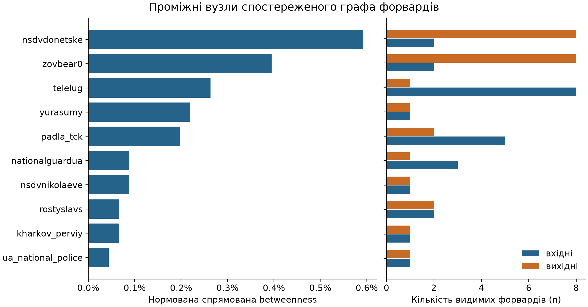
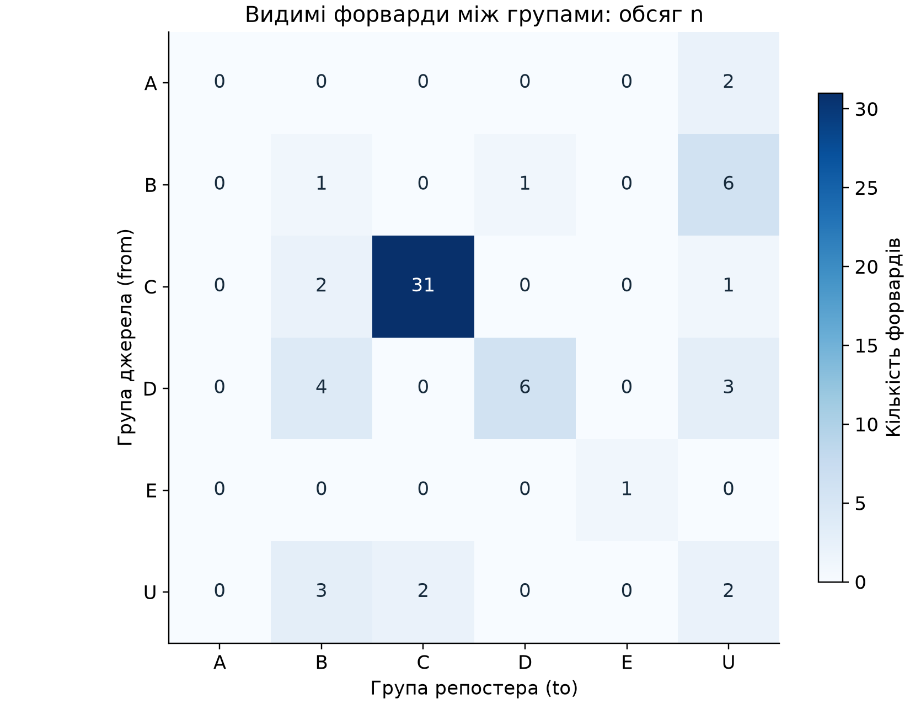
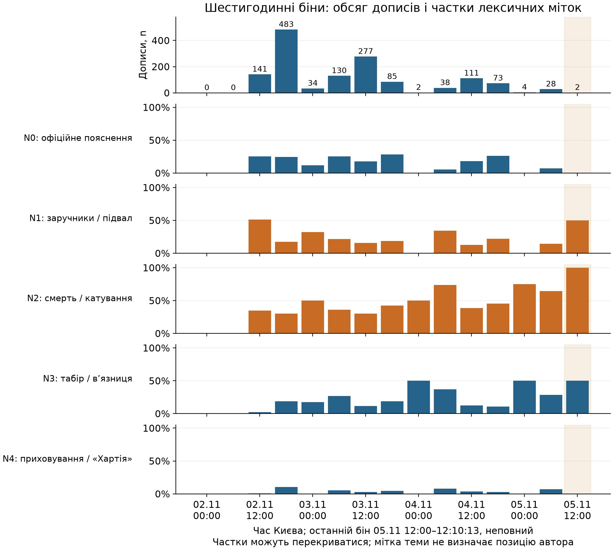

# Telegram: описова мостовість форвардів і динаміка тематичних міток

**Вікно:** 2 листопада 2026 00:00 — 5 листопада 2026 12:10:13 за Києвом, права межа не включається. Аналіз спостереженої панелі, не всього Telegram. Результати та походження чисел: [results.json](telegram_network_dynamics_20261106/results.json); відтворення — `python src/analysis/telegram_network_dynamics.py`.

## Що показує граф

Видимі метадані форвардів утворюють **69 вузлів, 60 спрямованих зв’язків і 65 форвардів**. У графі 12 слабко зв’язних компонент. Вузли — лише кінці зафіксованих зв’язків; канали без видимих форвардів сюди не включені. Зв’язок спрямовано **від зазначеного джерела до репостера**. Найбільша описова betweenness у `nsdvdonetske` та `zovbear0`, але всі їхні безпосередні вхідні та вихідні зв’язки залишаються всередині групи C. Їхнє місце в рейтингу не означає посередництва між українськими й російськими групами.

| Вузол | Група | Betweenness, нормована | Вхідний обсяг n | Вихідний обсяг n | Обсяг зв’язків з іншими групами, вхід + вихід |
|---|---|---:|---:|---:|---:|
| nsdvdonetske | C | 0,005926 | 2 | 8 | 0 |
| zovbear0 | C | 0,003951 | 2 | 8 | 0 |
| telelug | U | 0,002634 | 8 | 1 | 7 |
| yurasumy | C | 0,002195 | 1 | 1 | 0 |
| padla_tck | B | 0,001975 | 5 | 2 | 7 |

Дані таблиці: [node_metrics.csv](telegram_network_dynamics_20261106/node_metrics.csv). Показник betweenness — сума часток найкоротших **спрямованих незважених** шляхів, що проходять через вузол, без включення кінцевих точок; нормування на `(69−1)×(69−2)`. Число `n` використано окремо як обсяг видимих форвардів, **не як відстань**. Вхідний обсяг описує форварди, отримані каналом з інших джерел; вихідний — форварди, де цей канал зазначений джерелом. Це не кількість унікальних читачів чи переглядів. Нормована betweenness не є часткою дописів.

## Міжгрупові переходи

Між різними групами проходять **20 із 60 зв’язків** та **24 із 65 форвардів**. Усередині C — 31 форвард, усередині D — 6. Серед переходів між різними групами найбільші B→U (6), D→B (4), D→U (3), U→B (3); C→B — 2. Оскільки U означає невстановлену групу, його не можна трактувати як самостійний політичний табір. Повна матриця, включно зі структурними нулями: [group_transitions.csv](telegram_network_dynamics_20261106/group_transitions.csv).

Групи успадковано з вхідного файлу: A — місцеві пабліки; B — українські неофіційні; C — російські/проросійські; D — офіційні установи та редакційні медіа; E — іноземні/емігрантські; U — невідомі. Це класифікація каналів у проєкті, не встановлення їхніх операторів або державного керування; вона не переглядалась у цьому аналізі.

Є 53 спрямовані двокрокові шляхи `u→v→w` із різними `u` та `w`; у двох також присутній прямий зв’язок `u→w`. Частка такого замикання — 2/53, або 3,77%. Це точно визначена топологічна характеристика, а не причинна транзитивність: агрегований файл не доводить, що два зв’язки стосуються того самого повідомлення або утворюють послідовність у часі. Навіть видимий шлях A→B→C не доводить передачі конкретного твердження через B.

Приховані імена джерел, ручне копіювання, скриншоти, редагування та видалення дописів не утворюють надійно спостережених форвардних ребер. Інші джерела можуть лежати поза панеллю. Тому рейтинг чутливий до охоплення та вибору вузлів; низьке значення не означає відсутності поширення. Високе значення не встановлює організатора, оператора, намір, реальний вплив чи координацію.

## Тематичні мітки в шестигодинних бінах

Для **1 408 дописів** побудовано **15 бінів** від початку календарного вікна у часовому поясі `Europe/Kyiv`: 14 повних шестигодинних і один неповний, 5 листопада 12:00–12:10:13. Два початкові біни порожні. Останній містить **лише 2 дописи**, тому, наприклад, 50% означає один допис, а 100% — два. Неповний бін виділено на графіку, а число дописів наведене над стовпчиками верхньої панелі.

| Лексична мітка | Дописів із міткою | Частка від 1 408 |
|---|---:|---:|
| N0: офіційне пояснення | 307 | 21,80% |
| N1: заручники / підвал | 301 | 21,38% |
| N2: смерть / катування | 505 | 35,87% |
| N3: табір / в’язниця | 230 | 16,34% |
| N4: приховування / «Хартія» | 81 | 5,75% |

Знаменник кожної бінової частки — **усі релевантні дописи в цьому біні**, а не сума міток, переглядів чи каналів. 394 дописи мають кілька міток; 557 не мають жодної з N0–N4. Разом є 1 424 призначення міток, тому частки не повинні сумуватися до 100%. Перекривні мітки показані окремими рядами, без накопичення в один стовпчик. Для порожнього біна записано `messages=0`, `label_posts=0`, `share=0`, `empty_bin=True`: це явна технічна конвенція для графіка, а не оцінена ймовірність відсутності теми у всьому Telegram. Повні чисельники, знаменники й межі: [narrative_shares_6h.csv](telegram_network_dynamics_20261106/narrative_shares_6h.csv).

Ці мітки успадковано з наявної regex-розмітки. **Згадка теми не визначає позицію автора**: спростування, цитування, репортаж і підтримка твердження можуть містити ті самі слова. Особливо слабка наявна відкладена перевірка N1/N2: для N1 precision 0,20 та recall 0,25; для N2 — 0,18 та 0,40, на вибірці 40 дописів з іншого зрізу. Для N4 — обидва показники 0. Це не калібрування всіх 1 408 дописів. Джерело: [agreement_test_v2.csv](20261105T101013Z/validation/agreement_test_v2.csv). Наведені частки характеризують спрацювання лексичних правил у цій панелі; з них не можна оцінювати поширеність переконань, підтримку чуток чи «перемогу» наративу.

## Чому тут не обчислюється Granger

Granger-тест із p-значеннями **не запускався**. Є лише 15 часових точок, серед яких два порожні біни й один короткий неповний; це одна подієва хвиля зі спільними інформаційними приводами, різкими змінами обсягу й слабко перевіреними мітками. Після додавання лагів ефективна інформація ще зменшується. Різна довжина останнього біна також порушує зіставність рахунків, а нормовані частки у бінах із двома дописами нестабільні. Ці умови не дозволяють надійно відокремити передбачення від спільного шоку, добового ритму, копіювання та нерівного охоплення панелі. Перевірка багатьох пар/лагів додатково створила б проблему множинних порівнянь.

Часові ряди придатні для **розвідувального опису й формування гіпотез**. Для серйозної лагової перевірки потрібні довше рівномірне спостереження, кілька незалежних епізодів, перевірена розмітка теми й позиції, стабільна панель, попередньо визначені лаги та корекція множинних порівнянь. Навіть тоді Granger-передбачуваність сама по собі не встановлює причинності, координації чи оператора каналу.

## Відтворення та перевірки

Входи — незмінені [forwards_edges.csv](continuation_20261105/forwards_edges.csv) і [relevant_posts.csv](continuation_20261105/relevant_posts.csv). SHA-256 входів, версії бібліотек і результати перевірок записано в [results.json](telegram_network_dynamics_20261106/results.json); обчислення — у [telegram_network_dynamics.py](../src/analysis/telegram_network_dynamics.py).

Перевірено унікальність URL дописів, узгодженість груп кожного вузла, додатні цілі обсяги ребер, рівність сум вхідних і вихідних ступенів числу ребер, рівність обсягів сумі `n`, узгодженість групової матриці та сум часових знаменників із 1 408. Суми чисельників кожної мітки узгоджуються з початковою розміткою. [Контрольні приклади](../tests/check_telegram_network_dynamics.py) перевіряють найкоротший шлях із прямим скороченням проти ланцюжка, обсяг окремо від відстані, замикання двокрокового шляху, часову межу, порожній бін, перекриття міток і неповний останній бін. Виконання: `python tests/check_telegram_network_dynamics.py`. PNG перевірено візуально; вони придатні для розміщення у PDF. Ці перевірки засвідчують арифметичну й структурну узгодженість, не причинність.
